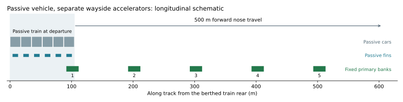

# Active direction: passive trains and short wayside accelerators

**No powered bogies, onboard traction motors or onboard traction store are
proposed in this development direction.** The twelve wheel bogies remain passive.
All traction equipment stays beside the track near stations and their approaches.
An optional supercapacitor buffer would be stationary equipment, not vehicle
equipment. Existing service batteries, HVAC, doors, ATP and independent service,
emergency and parking brakes remain.

This is the lead research direction recorded in
[station-accelerator-development.toml](../../../campaigns/station-accelerator-development.toml).
The selected reference already has passive bogies; no fictitious motor/store
mass saving is subtracted from it. The change being studied is the primary
layout. Earlier [powered-bogie comparisons](../propulsion-layout/README.md) are
retained secondary research, not the active vehicle proposal. The reference
selector and historical evidence remain unchanged.



*Longitudinal arrangement only; vertical separation is illustrative. Available
thrust, thermal duty, clearance and complete installation remain unverified.*

## Five aligned short sections

The cleanest next geometric experiment uses five 20 m primary banks. With the
berthed train rear at 0 m and nose at 104.5 m, they start at:

`91.5, 191.875, 292.25, 392.625, 493.0 m`.

The first bank lies under the front reaction fin, avoiding the previous rear
starter site. Summed active primary length is **100 m**, distributed across a
421.5 m installation span. The last bank ends at 513 m from the platform rear,
about 408.5 m beyond the train's departure nose. These are separate short units
along the launch approach, not a single continuous winding.

This arrangement retains the earlier six-bank experiment's **9 m minimum summed
overlap** and **5.75 m worst best-single-fin overlap** throughout 500 m of nose
travel. It uses one fewer site and 16.7% less summed bank length. Those are
quantity reductions, not proven installation-cost or available-thrust savings.

A five-bank, 17.5 m variant reduces summed primary length to 87.5 m while retaining
9 m aggregate overlap; its worst individual overlap falls to 4.5 m. A five-bank,
21.5 m variant trades additional stock for greater individual overlap. Bank
count, position and length remain revisable, not universal railway requirements.

[Generated findings](findings.md), [the numerical packet](comparison.json.gz)
and [its source/payload manifest](manifest.json) preserve these alternatives and
the original three-/six-site comparisons. The bounded run retains five geometric
layouts, 18 lead-layout load/distance/grade requests and five single-site faults.

## Traction stays wayside; force still needs proving

The train carries passive aluminium fins. Only one or two banks are active at
many positions, and one bank can be responsible for the full train force. The
normal inherited mass requires about **66.6 kN and 1.33 MW mechanical** at the
reference launch target. There is no multiplication of a local force result by
five or six, and no force scaling from overlap length. Actual electrical input,
current, voltage, heat and finite-position thrust remain unknown.

A shared station power room/DC bus, cooling plant and optional stationary energy
buffer are practical design hypotheses. The number of inverter channels, feeder
circuits and independent branches needs a switching/current-control and failure
study; it is not assumed to be one cheap drive serving every condition.

The short banks still act over enough forward travel to accelerate gently:
20 m/s at 0.4 m/s² needs 500 m. The lead-layout target-demand calculations cover empty, normal
and crowd-control mass accounts at 1.5/2 km and level/up/downhill hypotheses.
They request acceleration where contact is geometrically possible, not where
validated force is known. Reaching a target numerically is not a physical journey.
Adverse coasting and braking failures remain visible.
Alternative banks retain geometric diagnostics; identical required-motion
projections are not repeated as additional engineered candidates.

## No hidden onboard drive for failure recovery

An unavailable initial bank leaves no propulsion overlap at the specified berth;
dispatch must be held unless a separately qualified redundant starting
arrangement exists. A middle-site failure creates a contact gap. Momentum may
carry a train across it, but continued motion, safe stopping and degraded service
need a validated force/brake/protection evaluation.

Fault calculations retain the full installed five-bank geometry and stock.
Disabling a bank does not remove hardware or reduce installed cost. With no
onboard traction, protected external rescue/towing, rated load paths and
evacuation remain necessary. This study does not add a recovery motor to solve
those obligations.

Independent braking, receiving arrangements, containment, fin/hanger/coupler
forces, worn-wheel/suspension clearances, cooling, maintenance access and whole-
life prices remain open. Launch-only primary length cannot be compared directly
with the reference's 900 m shared launch/receiving allowance as a cost saving.

## Reproduce the current priority

```bash
./osr design railway plan
.venv/bin/python -m engineering.design_search.station_accelerators plan
.venv/bin/python -m engineering.design_search.station_accelerators compare
.venv/bin/python -m engineering.design_search.station_accelerators publish
.venv/bin/python -m engineering.design_search.station_accelerators verify
.venv/bin/python -m pytest -q --import-mode=importlib engineering/design_search/tests/test_station_accelerators.py engineering/design_search/tests/test_sparse_launch.py tools/automation/tests/test_ci_architecture.py
```

Retained P1–P7, adaptive, coupled and powered-bogie studies keep their original
source contracts. Priority identity, physical layout identity, fault/evaluation
identity and physical acceptance are separate. No new materialized train,
available-force map, native admission, cheapest railway or operating release is
claimed.
