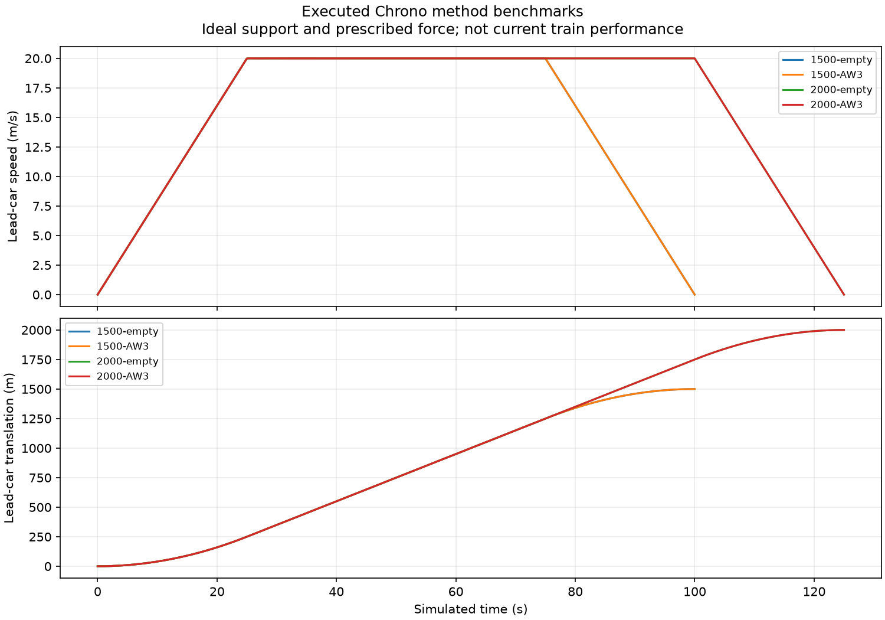

# Six-car journey simulation programme

OpenSourceRail aims for simple construction, low whole-life cost and high passenger throughput. All permanent magnets and support/guidance coils remain onboard; ordinary concrete beams carry passive steel facings. Stations provide launch and receiving propulsion. GFRP and aluminium-extrusion body alternatives remain separate identified designs.

**Result: 9 completed evidence preflights; no integrated journey admitted.** The equipped mass distribution, flexible body and nonlinear 3D force/current/loss maps are not complete for one common candidate. These attempts therefore produce no fabricated travel, stable hover or post-fault capture trajectory.

5 separately identified Chrono benchmarks exercise six bodies and finite station zones with ideal straight support and prescribed forces. They are numerical method demonstrations; the actual train has not acquired their force, power or stability capability.

[Summary](summary.json) · [All case gates and unevaluated outputs](evidence-attempts.json) · [Source-bound option review](option-review.json) · [Vehicle inventories](vehicles.json) · [Magnetic evidence](magnetic-evidence.json) · [Digital task contracts](digital-programme.json) · [Integrity receipt](manifest.json) · [Method and commands](../../../engineering/trip_dynamics/README.md)

| Case | Engineering preflight | Dynamic execution |
|---|---|---|
| A-hover-empty | unknown | not-run |
| B-hover-AW3 | unknown | not-run |
| C-1500-empty | unknown | not-run |
| D-1500-AW3 | unknown | not-run |
| E-2000-empty | unknown | not-run |
| F-2000-AW3 | unknown | not-run |
| G-2000-asymmetric | unknown | not-run |
| H-2000-hot-AW3 | unknown | not-run |
| I-2000-receiver-loss | unknown | not-run |

## Separately executed Chrono benchmarks

| Numerical case | Step, ms | Maximum terminal position error, m | Work residual / absolute external work |
|---|---:|---:|---:|
| benchmark-1500-empty | 1.0 | 2.70102e-08 | 4e-05 |
| benchmark-1500-AW3 | 1.0 | 2.71791e-08 | 4e-05 |
| benchmark-2000-empty | 1.0 | 3.58148e-08 | 4e-05 |
| benchmark-2000-AW3 | 1.0 | 3.06225e-08 | 4e-05 |
| benchmark-2000-AW3 | 0.5 | 4.72553e-08 | 2e-05 |

The trace is sampled at 10 Hz; native integration, work/impulse accounting and extrema run at every mechanical step. The [smaller-step comparison](timestep-comparison.json) checks the full sampled path and coupler peaks as well as arrival. Two step sizes do not prove continuum convergence.

## Actual nonlinear 3D neodymium coupon

Three bounded attempts used the source-bound finite N35UH Halbach coupon at 80°C, 12 mm and zero coil current. Newton diverged, a fine-mesh run timed out, and a Picard repair stalled. **No force or usable map credit is given.** The independent manufactured 3D method fixture passed its analytical air-Maxwell check; that success does not validate the candidate coupon.

[Verified artifact inventory and dispositions](finite-coupon-verification.json) · [Exact input/mesh/log archive](finite-coupon-artifacts.tar.gz). Historical limitations include uncaptured stdout for the timed-out attempt and an unrecovered Python recipe for an earlier pre-solve syntax failure; their exact solver inputs remain identified. The later replay recipe does not relabel those executions.

The source option review executes 40 additional preflights across the canonical, retained-GFRP/neodymium and aluminium variants at 20/40/50/80°C, with empty and AW3 comparison loads. Their own mass ledgers and operating points stay distinct. It selects no integrated candidate and does not turn unknown installed mass or cost into zero.

The independent ideal target at 20 m/s and 0.8 m/s² is 100 s for 1.5 km and 125 s for 2 km, with 250 m acceleration and braking distances. It excludes drag, grades, jerk, auxiliaries and electrical limits. A 350 m zone length alone does not prove full-formation magnetic overlap. Comparison masses are retained allocations/material ledgers, not newly completed equipped vehicle masses.

The Rust current fixture executes the existing 50 µs controller/plant ABI and sensor-loss refusal; it is not a magnetic force model. The composite coupon is an analytical/finite-element method check, not an accepted body. Code_Aster and complete nonlinear candidate maps have their own explicit execution and applicability dispositions.

Every unexecuted field in the report is marked unevaluated. The task graph adds digital execution contracts while leaving physical qualification unchanged. Campaign `019219316193c9cfc234ca0330442f23a0828e2519468f295b3c892083fa640a`; engineering acceptance, configuration adoption and physical release remain false.
