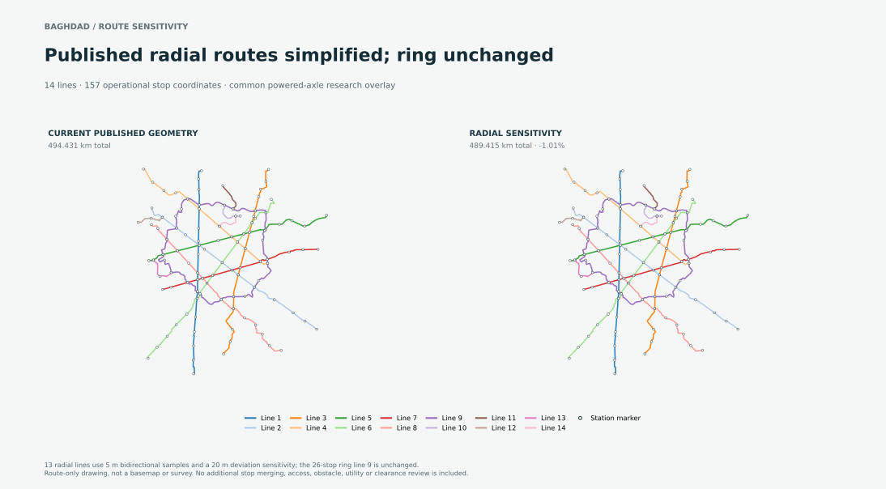

# Baghdad equal-propulsion route sensitivity

This corrected study starts from Baghdad's current published `anchor-preserving-chord-research` geometry, then prices a stop-preserving radial sensitivity under one common planning and propulsion evaluation. It keeps the vehicle and body identities fixed, applies `powered-axle-continuous-research` to all fourteen lines, simplifies the thirteen radial routes within a sampled 20 m deviation tolerance, and leaves the closed ring unchanged. It recalculates service, fleet, quantities, construction risk and all fourteen cost scopes.



Read [the results](RESULTS.md) for low/base/high costs, the parameter sensitivity for the large unverified right-of-way reserve, source identities and limits. The map is route geometry only; it has no surveyed basemap.

## Evidence package

- [Current attempt 05 archive](results/equal-propulsion-attempt-05.tar.gz), which regenerates route geometry under pinned Shapely 2.2.0. [Attempt 04](results/equal-propulsion-attempt-04.tar.gz) is retained as earlier successful evidence.
- [Attempt 01 CPU-limited archive](results/baghdad-equal-propulsion-route-study-01-attempt-01-failed.tar.gz), [attempt 02 superseded baseline archive](results/superseded-original-baseline-attempt-02.tar.gz), and [attempt 03 endpoint failure archive](results/attempt-03-degenerate-endpoint-failed.tar.gz) are retained with their dispositions.
- [Outer package receipt](results/package-receipt.json), source-staging and 266-city replay receipts, the [independent audit](results/independent-audit-summary.md), and [ROW/bridge risk sensitivity](results/row-bridge-risk-sensitivity.json).
- [Route-map renderer](render-route-map.py) reproduces the SVG from the successful sealed archive.

Attempt 02 used the seed's original route geometry and is superseded because it did not start at Baghdad's current published chord-aligned route. Attempt 03 then replay-verified that correct current baseline, but encountered a floating-point duplicate endpoint separated by about 1.12e-9 m. Attempts 04 and 05 record a sub-micrometre chainage snap only where the stop coordinate exactly equals the route endpoint; the stop coordinate is unchanged. Attempt 04 used Shapely 2.1.2 and freshly calculated the revised city study. Attempt 05 regenerated the same route geometry with the project-pinned Shapely 2.2.0; its baseline and revised city studies were exact source/request-matched cache results and replay-verified. The deterministic differential check compares Shapely/GEOS point-to-line distances with the original all-pairs method and reports 0 m error at a `1e-7 m` check tolerance.

## Reproduction

Use the complete source tree at commit `bfa3cbd3abb8336e3c35981cf5991811662b1065` and the pinned current outline publication. Materialize the exact missing city-catalogue files first if using a sparse checkout, following the [Samawah study's staging instructions](../samawah-equal-propulsion-route-study-01/README.md#reproduction). Then run:

```sh
python3 run.py \
  --root /path/to/OpenSourceRail \
  --output /path/to/private-run/baghdad-equal-propulsion-attempt
```

The worker limits CPU to 600 seconds, address space to 3 GiB, each file to 32 MiB and open files to 256. These are process limits, not an OS sandbox. Attempt 05 used Shapely 2.2.0, matching the project pin. A fresh uncached city recalculation under 2.2.0 remains open; exact cached studies are independently replay-verified. The source worktree's `build/city-studies/` contains immutable request-keyed cache artifacts used by the workflow.
