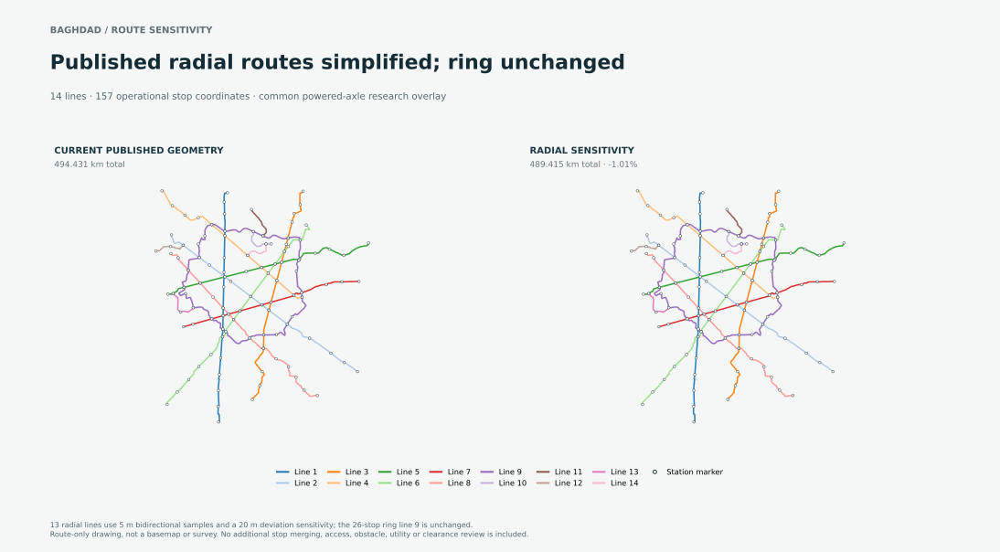

# Baghdad route sensitivity from the current published geometry

## Result

This corrected comparison starts from Baghdad's **currently published `anchor-preserving-chord-research` alignment** (494.431 km), then simplifies 13 radial routes between their existing operational stops. It retains the closed 26-stop ring as published. The route-only sensitivity reduces total geometry to **489.415 km (−5.016 km, −1.01%)** and the modeled fleet request from **511 to 508 trainsets**.

The calculated costs rise under this model: base installed CAPEX goes from **$8.248bn to $9.109bn (+$861.4m, +10.44%)**; base 30-year NPV goes from **$15.890bn to $16.714bn (+$824.1m, +5.19%)**. The principal modeled driver is an additional **$704.1m base Class C corridor risk allowance** for assumed right-of-way, access/obstruction and crossings. This is not a measured land, utility or bridge cost, and the result does not show that straight routes inherently cost more.

The map contains 157 operational stop coordinates in both cases. The city source has 159 mapped markers, with two pre-existing close-stop pairs already represented as 157 operational station complexes. This edit adds no further merges and does not test the separate square-ring idea.

## Common comparison inputs

| Input | Both cases |
|---|---:|
| Physical vehicle / body identity | `756a6887…` / `9489e4f2…` |
| Formation / routes | Six cars; 14 lines; 157 operational stop coordinates |
| Peak demand | 4,000 passengers/hour/direction/line; planning assumption, not surveyed |
| Occupancy / availability | 85% / 99%; assumed, not achieved |
| Headway / speed cap | 200 s / 20 m/s (72 km/h); planning assumptions |
| Propulsion evaluation | `powered-axle-continuous-research` on every line |
| Cost method | `project-make-buy`; Class C; USD |
| Geometry method | Stop-to-stop Douglas–Peucker; 5 m bidirectional samples; 20 m maximum sampled deviation |

The propulsion overlay adds a modeled **1,000 kg/car**, four motors per car and **749.194 kW/car** rated power. It has no physically supported available-force map. Each line carries a distinct research-configuration identity. This is not the selected passive-wheel v0.6 vehicle or an operating-force demonstration. Service demand, headway, occupancy, availability, vehicle and propulsion policy are held common; calculated dwell changes on eight lines, so the result is an equal-input comparison rather than identical measured service trajectories.

The current published outline's own summary is **494.431 km, 533 trainsets, $8.355bn base CAPEX and $16.026bn base 30-year NPV** under its published configuration. Those totals are not the equal-propulsion control above: this comparison explicitly applies the powered-axle research overlay to both geometries. Do not compare the powered-axle study's 511-trainset/$8.248bn baseline as if it were the current published outline cost.

## Cost comparison

| Measure | Current published geometry, equal-propulsion control | Radial sensitivity | Change |
|---|---:|---:|---:|
| Route length | 494.431 km | 489.415 km | −5.016 km (−1.01%) |
| Requested fleet | 511 | 508 | −3 (−0.59%) |
| Installed CAPEX, low | $2.206bn | $2.373bn | +$166.7m (+7.56%) |
| Installed CAPEX, base | $8.248bn | $9.109bn | +$861.4m (+10.44%) |
| Installed CAPEX, high | $51.432bn | $57.612bn | +$6.180bn (+12.02%) |
| 30-year NPV, low | $4.430bn | $4.584bn | +$154.0m (+3.48%) |
| 30-year NPV, base | $15.890bn | $16.714bn | +$824.1m (+5.19%) |
| 30-year NPV, high | $92.929bn | $99.032bn | +$6.103bn (+6.57%) |
| Base CAPEX per route-km | $16.68m/km | $18.61m/km | +11.57% |

All 14 low/base/high lifecycle scopes are present. Their base totals reproduce the stated NPV; direct capital lines reproduce CAPEX. Base 30-year NPV changes by **+$890.023m in construction** and **−$65.928m net across the other 13 scopes**, for a total **+$824.095m**.

### Corridor-risk allowance and sensitivity

The published alignment already contains a **$340.609m base** Class C risk allowance. The radial edit adds **$704.132m base**, producing a revised total risk line of **$1.044741bn**. The modeled added quantities for this route edit are 392,629 m of geometry-changed radial corridor, an assumed 20 m right-of-way width (7,852,585 m²) and an assumed 5% bridge-risk fraction (19,631 m); additional walkway quantity is zero. The proxy uses transferred rates and is not survey evidence or a quote.

| ROW width assumption for the added radial corridor | 0% bridge-risk fraction | 2.5% bridge-risk fraction | 5% bridge-risk fraction |
|---:|---:|---:|---:|
| 5 m | $293.822m | $352.716m | $411.611m |
| 10 m | $391.329m | $450.224m | $509.118m |
| 20 m | $586.344m | $645.238m | $704.132m |

The table varies only the new-route reserve and holds the existing $340.609m baseline risk allowance fixed. A 0% bridge fraction does not prove there are no bridges; a narrower assumed ROW does not prove land availability or clearance. This is parameter sensitivity, not a recalculated city total. Full inputs and arithmetic are sealed in [the reserve-sensitivity record](results/row-bridge-risk-sensitivity.json).

The model assumes $75,000 IQD/m² land pricing, 1,510 IQD/USD conversion, $500 per geometry-changed route metre for site/obstruction risk, $6,000 per assumed bridge-route metre, and a 1.0 transfer multiplier. These are source-bound model rates, not locally verified transaction prices.

## Geometry and operating limits

Thirteen radial lines are simplified from the current published route, interval by interval between the same operational stops. The maximum 5 m-sampled deviations are **18.113–19.960 m** under the 20 m screening tolerance. The route's 157 operational stop IDs and coordinates match between cases; the 26-stop ring line is coordinate-identical. No station relocation, added stop merge, access walk, noise, obstacle, utility, geotechnical or construction-clearance study is performed.

The seven endpoint-chainage adjustments recorded in the route packet snap values within **1 micrometre** to an already identical route endpoint, with stop coordinates unchanged. This handles floating-point duplicate endpoints only; it does not move or merge stations.

Attempt 02 used the seed's `original` geometry (513.140 km), not the current published alignment. It is retained as superseded evidence and is not the comparison reported here. Attempt 03 replayed the correct 494.431 km baseline but stopped at a sub-micrometre duplicate endpoint. Attempt 04 preserves that failure, performs the endpoint normalization above, freshly evaluates the revised route, and replay-verifies both cases. Attempt 05 regenerates the same simplified route geometry with the project-pinned Shapely 2.2.0; the differential distance-kernel check again reports 0 m observed error against a 1e-7 m check tolerance. In attempt 05, both city studies are exact source/request-matched cache results and replay-verified. The revised-route city study was freshly evaluated in attempt 04; a fresh, uncached city recalculation under Shapely 2.2.0 remains open.

## Evidence identities and maturity

| Evidence | Identity |
|---|---|
| Source commit | `bfa3cbd3abb8336e3c35981cf5991811662b1065` |
| Current published outline manifest | `332e3362c179462fd000af41965dfc1b75096ff11d00b7c109521d5c6bd166b5` |
| Separate 266-city replay-run manifest | `c2bf7569ac00a14d74fda0117a4474aad1943280e9d3a4d77f65924e8d3ead33` |
| Baghdad planning seed / outline evaluation | `53f0cc845e2e67e8c164885829e3d4e3cf4e782ba08a02d92fdf75453e3dc649` / `f1715c1fc8212bb0d107a0e06cf8fbb8fbada7fe7889b5aa8182d8e21c585561` |
| Physical vehicle / body identities | `756a68870162f7559b052b05c9b201728c9f448e3bb61114f287848c02f2d3a3` / `9489e4f2666fd3b3c73232c86df3f12adf42a5531eb27373834cf3fecb1a3117` |
| Baseline / revised study IDs | `27fba762275d0e63d57a7b4bcf6483b7` / `c8cbb21fc69edce7d84b89b58cf00093` |
| Baseline / revised study manifests | `50d8d0e465bbef08af3d104ac7f880c18e3effb085d7dfa12a15d2cf40d8d7c6` / `9d9edddcfb01487ece77b4ffb6b4fd3d590aa7f09966a7cecfd681e4617929d2` |
| Route-generation / comparison / attempt manifest | `ec9f4d9ca4eceda0670ecf72757f64ef66667715f15ca48159e4faa03f9959aa` / `e66df4f4a78b32a0c98e7d6c24056c9ee0215906d11ac8e53a26c0b703166a2d` / `fe2717b4d53a406e15f14d595378bee34751f6478ef2fb1d95bd2ace288037cb` |

Attempt 05 reuses exact source/request-matched cached baseline and revised-route city studies and replay-verifies both. The revised-route study was freshly calculated in attempt 04. The attempt-05 route geometry was regenerated with Shapely 2.2.0 and matches attempt 04's simplified coordinates; it updates the generation identity and explicitly records the pinned engine. The current package carries failed attempts 01 and 03, attempt 02 as superseded original-baseline evidence, attempt 04 as prior successful route evidence, and the 50-member attempt-05 archive, source-staging receipt, outline-publication replay receipt, independent review and tool/version limits. Process limits were recorded; no OS sandbox was enforced. This is a calculated, unselected outline sensitivity. Physical, engineering, manufacturing, operating and movement-authority acceptance remain false.
