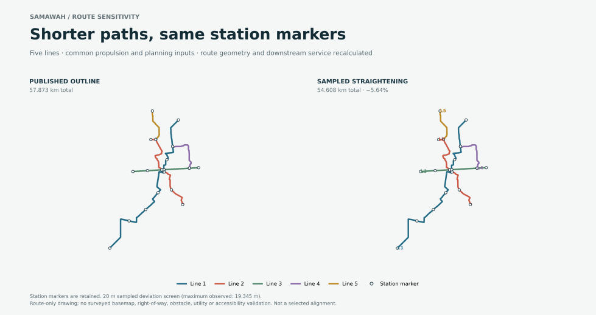

# Samawah equal-propulsion route study

This study compares route geometry under a fixed planning demand/headway envelope on the current Samawah planning seed. Both cases use the same six-car vehicle and the same explicit `powered-axle-continuous-research` family on all five lines. The revised case keeps the published station coordinates fixed, then recalculates runtime, adaptive dwell, fleet, quantities and costs. Dwell outcomes are therefore derived and can differ between cases; this is not a comparison with every service output held identical.

The experiment was generated against source commit `bfa3cbd3abb8336e3c35981cf5991811662b1065` and the regenerated 266-city outline publication (`332e3362…`). The publication and every city result were independently replay-verified. The previous publication (`9b9a6914…`) was preserved outside the worktree.

## Results

See [RESULTS.md](RESULTS.md) for the route, fleet, low/base/high prices, scope changes, the conditional route-risk allowance and the remaining limits.



The map is generated from the sealed GeoJSON files by [`render-route-map.py`](render-route-map.py). It is a route diagram, not a basemap or site survey.

The complete source-bound run package, including both city-study artifacts and manifests, is in [`results/equal-propulsion-attempt-02.tar.gz`](results/equal-propulsion-attempt-02.tar.gz). Its outer hash receipt is [`results/package-receipt.json`](results/package-receipt.json). The sparse-worktree input staging and independent 266-city replay receipts are in [`results/`](results/); the separate packet audit is [`results/independent-audit-summary.md`](results/independent-audit-summary.md).

Verify the packaged hashes with:

```sh
python3 verify-package.py
```

## Reproduction

Use a complete checkout at the pinned source commit and the current source publication. In a sparse checkout, `stage-sparse-source-inputs.py` materializes only the tracked city files required by the all-city source manifest; it records the exact paths and hashes and refuses to overwrite existing files.

```sh
python3 stage-sparse-source-inputs.py \
  --root /path/to/OpenSourceRail \
  --receipt /path/to/private-run/source-staging-receipt.json \
  --commit bfa3cbd3abb8336e3c35981cf5991811662b1065

python3 run.py \
  --root /path/to/OpenSourceRail \
  --output /path/to/private-run/samawah-equal-propulsion-attempt
```

The runner has 180 seconds CPU, 3 GiB address-space, 32 MiB per-file and 256 open-file limits. These are process resource limits; the execution did not use an OS sandbox. The runner retains exact city-study artifacts and verifies both studies with the repository replay path.

The front-page summary of this study is also linked from the root README. The attempt package and route map are reproducible from the sealed artifacts; package hashes can be checked with `python3 verify-package.py`.

## Scope

The 20 m value is a maximum sampled deviation tolerance, not a survey tolerance or route width. Geometry was independently simplified within each adjacent-stop interval; the stations were fixed and the maximum sampled two-way deviation was 19.345 m. The comparison is not a surveyed alignment, cost-optimised route, or route clearance assessment. Demand, occupancy, headway, speed cap and acceleration policy were held at the planning-seed values; route-dependent runtime and adaptive dwell were recalculated.

The powered-axle study is a research configuration, not the v0.6 selected reference. It uses a provisional 1,000 kg/car traction allowance, 100 kg/car rotating-equivalent allowance, four motors per car and continuous feed. No physically supported available-force map exists, so no physical journey or propulsion acceptance is claimed. City demand and prices remain planning and Class-C estimates.
