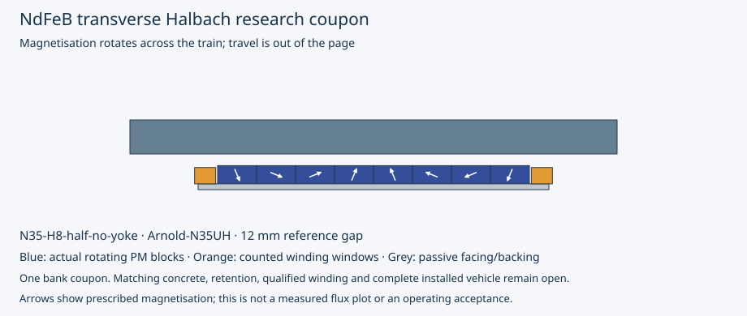

# Neodymium Halbach arrays and lighter vehicle equipment

OpenSourceRail aims for simple construction, low whole-life cost and high passenger throughput. This campaign investigates **named neodymium grades, genuine rotating Halbach arrays, aluminium-extrusion frames and lighter HVAC/doors/windows** together. All permanent magnets and suspension/guidance coils stay on the train; ordinary concrete guidebeams carry passive steel facings. Station propulsion remains a separate interface.

**Research result: useful magnetic and mass-reduction leads; no integrated train adopted.** The study retains **14 magnetic geometries, 36 checked operating points and 98 composed vehicle alternatives**. Material, numerical, control, thermal and physical-qualification states remain separate. The six-car, 17 m case keeps 120 normal/160 AW3 passengers per car, four 1.4 x 2.1 m doors and 14,400 passengers/hour/direction at 180-second headway.

[Project ethos](../../../README.md) · [Plan](plan.md) · [Complete comparison](summary.json) · [Magnetic worker](magnetic-worker.json) · [Bounded refinements](refinements.json) · [Aluminium/door/glazing study](equipment.json) · [HVAC heat and equipment study](HVAC.json) · [Integrity manifest](manifest.json)



## Neodymium was a new matched comparison

The retained earlier Halbach implementations use ferrite in station-propulsion coupons; the previous passive-facing campaign used a three-piece tilted-pole perturbation. Neither supplies a named-grade NdFeB transverse comparison. The new 4/8-segment arrays complete a full magnetic rotation across the vehicle, with equal-volume controls, smaller-volume revisions, iron-backed and no-yoke alternatives. Independent analytical/strong-side reversal tests check that the implementation is an actual Halbach arrangement.

Arnold N42SH and N35UH data distinguish published minimum remanence/coercivity from typical density and temperature coefficients. Named chemistry, density and source hashes are retained. The frozen field solver's legacy internal recoil branch name is `ferrite`; an explicit adapter supplies the actual NdFeB laws and creates no extra ferrite stock. Manufacturer curves and our linear-recoil interpolation do not replace batch measurements. [Material/source declarations](magnetic-worker.json).

| 12 mm, 80°C comparison | Known support stock, t/car | Upward force, kN/module | Recoil screen margin, kA/m | Point disposition |
|---|---:|---:|---:|---|
| F-iron-equal | 5.717 | 5.824 | 238.8 | usable point |
| N42-iron-equal | 6.465 | 51.003 | 652.1 | held / failed screen |
| N42-H4 | 2.468 | 40.824 | -318.8 | held / failed screen |
| N42-H8 | 2.468 | 49.179 | -99.9 | held / failed screen |
| N35-H8 | 2.468 | 41.089 | 233.5 | usable point |
| N35-H8-half-no-yoke | 1.376 | 14.921 | 223.1 | usable point |
| N35-H8-quarter-no-yoke | 0.834 | 4.578 | 213.3 | usable point |

The full N35UH eight-segment array has substantial capacity, but over-supports the unchanged-body mean load even at 20 mm in the 20°C sample. Capacity is not equilibrium. The smaller no-yoke proposal reduces PM volume from 0.012 to 0.006 m³/module; its listed support stock is **1.376 t/car**, including copper and aluminium backing. Coating, adhesive, retention, sensors, protection and complete cooling remain unknown. The separate retained propulsion band is still counted; a transverse support array does not substitute for the longitudinal station-motor field.

## Lighter complete-car comparisons

Only actual canonical support stock, exact frame IDs and eligible 500 kg door/500 kg fixed-glazing/800 kg HVAC ancestor allowances are replaced. The 5.2 t equipped-body aggregate and already-consumed frame budgets are never subtracted again. All other stock, propulsion, reserve and unlocated allocations stay. Hardware estimates and allocation substitutions are not weighed savings.

The declared next **magnetic experiment** uses `N35-H8-half-no-yoke` in the `lighter-services-two` comparison context. Its AW3 material/allocation scenario is **27.912–28.067 t/car**, with the HVAC installation band included once. Complete installed mass, CG, inertia and cost remain unknown.

At 80°C the sampled force is **14.921 kN/module** against **14.909 kN** at the upper mass scenario. The observed mesh/domain/air-contour force spread is **133.2 N/module**. That variation prevents a marginal nominal ratio from becoming a robust reserve claim: support states at the low/high installation scenarios are **unknown / unknown**. This estimate also excludes physical material, installation and 3D uncertainty.

## Aluminium extrusions are quantified

The comparison replaces 260 exact old frame-stock IDs representing 65 members, approximately **1,224.0 kg/car**. Panels, magnetic collectors, existing hardpoints and separately counted fasteners remain. New profiles match declared section-stiffness screens and include 130 end joints, 520 M8 bolts/crush sleeves, 260 gussets, isolation/bond material and 24 load spreaders.

| Aluminium frame proposal | Counted stock, kg/car | Change from removed frame, kg/car |
|---|---:|---:|
| 6061-T6-envelope | 1,535.5 | +311.5 |
| 6082-T6-deep-stringers | 1,487.5 | +263.5 |
| 6005A-T5-wide-stringers | 1,469.9 | +245.9 |

Aluminium's lower density does not guarantee a lighter equal-stiffness frame. These bounded proposals are heavier after the larger sections and joints are counted. The revised 6082 spreader passes its scalar elastic screen; global body shear/torsion, bracing, compression, fatigue, weld/repair strength, interfaces and deep-profile clearances remain open. Composed roof loads are recalculated for the changed vehicle mass. Extrusion member positions preserve their own attachment datums. A broader structural redesign may still improve the outcome; this is not a proof that every aluminium chassis is heavier.

## HVAC, doors and windows can be redesigned

The lighter door/window takeoff retains all four openings and includes skins, cores, frames, seals, bonds, glass/PVB and supplier-reference operators. Mechanism weights of 41/46 kg are not complete door weights or confirmed 1.4 m installations. Proposed solar-control 6.76 mm laminated glazing reduces material and solar-load scenarios; impact, fire, scratch, retention and emergency provisions remain unqualified. No polycarbonate saving is credited without an actual qualified construction.

Two current UL700EM electric-compressor bus packages total **384 kg** and 66 kW nominal thermal capacity. The explicit installation scenario is **469–624 kg/car**, leaving a useful target below the inherited 800 kg allowance. Rail adaptation, full 50°C capacity/power maps, fresh-air/filter pressure, failed-unit duty and possible recovery hardware remain unknown. Their 400 V AC supply also needs a counted compatible train supply; low-voltage auxiliary current is not compressor power.

At the retained indoor conditions and ventilation scenario, the one-car 50°C AW2 load is **69.6 kW thermal** with clear glazing, **65.1 kW** with proposed solar-control glass and **51.9 kW** with explicitly assumed recovery plus fan power. The humid AW3 closed stationary case reaches **107.9 kW**. Nominal cooling capacity, electrical input and ambient derating are different quantities. Passenger heat and fresh-air demand do not fall with structural mass; reducing ventilation receives no comfort/compliance credit.

## What is still blocking

The retained 0.55 winding-fill screen is not met by the counted packs. The half-volume +20 A experiment adds only **193.9 N/module**, while reaching **5 A/mm²** and **350.3 W/module** DC copper heat. It is a one-sided observation, not a validated derivative, controller or repeated thermal duty. A useful segmented/differential trim winding and its installation must be designed before motion credit.

Passive lateral alignment, roll/multisupport stability, fault handling and finite-end/joint magnetic drag remain unresolved. A matching concrete cross-section and attachment load path have not been generated; existing beam mass/capacity is not transferred. The ordinary guideway remains passive. No route/speed reduction or passenger-capacity cut is adopted to obtain a passing score.

The native package is **one selected magnetic coupon and same-length steel facing**, not a complete car, aluminium chassis or concrete beam. [FreeCAD](native/model.FCStd) · [STEP](native/model.step) · [Actual reopen/volume receipt](native/native-cad.json)

## Reproduce

Use fresh output directories for a new execution. The following runs 32 reference points, three bounded volume/current refinements and one nonlinear confirmation. Ingestion rejects relabelled temperatures/gaps, altered recipes and missing/duplicate coverage.

```bash
OPENBLAS_NUM_THREADS=1 .venv/bin/python - <<'PY'
from pathlib import Path
import runpy, shutil
from engineering.vehicle_optimisation import magnets, campaign
p = Path('build/vehicle-optimisation/replay-worker')
p.mkdir(parents=True, exist_ok=True)
magnets.study(p)
shutil.copyfile('engineering/vehicle_optimisation/recipes/refinement_recipe.py', p/'refinement_recipe.py')
runpy.run_path(str(p/'refinement_recipe.py'), run_name='__main__')
value = next(v for v in magnets.candidates() if v['sample_id'] == 'N35-H8')
result = magnets.evaluate_reference(value, temperature_C=80., settings=dict(steel_model='nonlinear_repo_proxy'))
(p/'nonlinear.json').write_bytes(magnets.encoded(result))
campaign.run('build/vehicle-optimisation/replay', worker_study=p/'study.json',
             refinements=p/'refinements.json', nonlinear=p/'nonlinear.json')
PY
OPENBLAS_NUM_THREADS=1 .venv/bin/python -m pytest --import-mode=importlib -q engineering/vehicle_optimisation/tests engineering/passive_suspension/tests
OPENBLAS_NUM_THREADS=1 .venv/bin/python -m engineering.vehicle_optimisation.campaign verify --output docs/design-engine/vehicle-optimisation
```

The verifier rebuilds the derived mass/thermal/structural reports and selections from the current sources and retained field primitives without rerunning FEM. Digital progress does not complete physical qualification. Campaign `289fe34c0ac1c0090937acb4438a7d77f5a8c20d9488d6da6579a61f6a73b145`; all adoption and engineering-release flags remain false.
