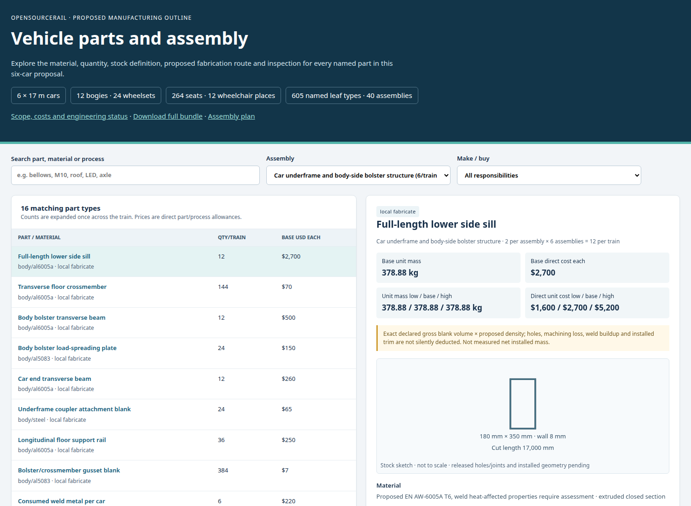

# Vehicle parts, manufacture and assembly

The six-car manufacturing proposal now contains **605 named leaf-part types in 40 assemblies**.
Each part identifies its material, quantity, stock dimensions or bought-component
envelope, manufacturing route, fixings/joining, proposed tolerance basis,
inspection and maintenance-removal method. This is a useful completed outline
breakdown; detailed released drawings and physical qualification remain later gates.



**[Open the searchable part catalogue](index.html)** — select a subsystem, search a
part or material, and open its dimensional stock sketch, proposed route and checks.
[Machine-readable full bundle](manufacturing-bundle.json.gz) ·
[Materials](materials.json) · [Cut/stock schedule](stock-schedule.json) ·
[Assembly plan](assembly-plan.json) · [Downstream handoff](handoff.json) ·
[Disabled business draft](business-draft.json).

## What is counted

- **12 passive bogies, 24 wheelsets and 48 axleboxes:** frame members, wheel/axle forgings,
  bearings, seals, springs, dampers, emergency support, discs, calipers/actuators,
  local WSP equipment, guards, pins, bolts, washers and retainers.
- **Six car structures:** lower sills/bolsters, side/roof members, floor, sandwich-panel
  skins and cores, adhesive/weld allowances, repairable linings, roof layers,
  equipment brackets and individually counted attachment hardware.
- **264 fixed chairs and 12 wheelchair places:** seat shells, frames, cushion/fabric
  proposals and attachments; wheelchair places do not acquire extra seats.
- **12 one-sided door openings, 24 moving leaves and 110 panes:** mechanical belt/reducer,
  carriages, rollers, tracks, latches, manual release, closing-edge rubber, separate
  monitored sensor inserts, motors, controllers, switches, cable carriers, seals and fixings.
- **Five inter-car couplers and five separate passenger gangways:** drawgear and restraints,
  floor bridges, articulation/support elements, bellows, rubber/fabric frames, clamp strips,
  corners, fasteners, air hoses, electrical jumpers and essential lights. Two end/rescue
  couplings are also counted. Gangways do not replace load-bearing couplers or bogies.
- **Service systems:** simple LED lighting, battery modules/racks, separate terminal and
  coolant fittings, active pack cooling, auxiliary conversion, HVAC pressure components,
  ducts/drains, brake/suspension air, controls, cable routes, optional-interface passive
  aluminium secondary and the retained roof-PV research function.

The **110,404 expanded BOM units** include individual fasteners,
cut strips, consumable/charge allowances and bought subcomponents. They are a proposed
counted schedule, not a measured count of every internal semiconductor, cell or sealed
compressor part. Such bought-unit internals and delivery inclusions require supplier drawings.
Parent assembly weights, original vehicle category allowances and cells already inside
battery modules are not added again.

## Simple LED lighting

Each car has two 12 m rows made from **16 replaceable 1.5 m, 12 W LED modules**, plus four 6 W
vestibule lamps. Normal output demand is **216 W/car**; two separate 150 W drivers feed
four protected half-circuits. Four 3 W emergency fixtures/car and two 3 W fixtures/gangway
use independent essential feeds. No inter-car HV or low-voltage power buses are paralleled.

At the declared 90% driver efficiency, total train lighting input is approximately
**1.55 kW**. The 2.5 mm², 7.5 m half-route hypothesis gives about **0.292 V drop at 2.25 A**
with the stated 80°C copper model. This is necessary electrical sizing arithmetic;
illumination, glare, EMC, protection coordination, hot derating and emergency tests remain open.
The lighting estimate does not resize the retained 82.8 kWh/car service-energy hypothesis.

## Materials and local manufacture

Prefer repeatable cut/folded/extruded members, accessible positive fixings, replaceable
panel/door/light modules and controlled jigs. Each material has a proposed grade/form
and explicit qualification dependency. Examples include weldable aluminium frame sections,
5052-H32 folded service enclosures, structural steel bogie stock, wheel/axle/bearing
components requiring certification, composite panel skins/cores, railway glazing and fire/smoke-qualified elastomers.
A generic rubber or household diffuser is not evidence of railway fire performance.

The make/buy assignment distinguishes local fabrication, standard purchased hardware
and qualified bought equipment. It does not assume that a new local factory is automatically
cheaper: shared tooling, final assembly hours, production rate, yields and capital remain
explicitly outside this subtotal. No invented Chinese or repeat bulk discount is applied.
Current component quotations can replace individual allowance rows without changing the
physical geometry; their evidence and the resulting evaluation identity must change.

## Quantities and estimated direct cost

The six-car sum of declared stock masses and bounded component allowances is
**78.49 / 89.81 / 106.60 t** (low/base/high).
These are not verified installed masses, CGs or inertia. Gross stock and estimated bought
masses are labelled individually. The old 19.22 t/car category account is comparison-only;
the difference is not an established weight saving.

Declared direct part/process subtotals are **$507,494 / $1,064,002 / $2,350,849** across six cars.
They are engineering allowances, not quotations or a complete vehicle factory price.
Final car assembly/commissioning, shared plant/tooling, taxes/duties, delivery,
qualification, warranty and complete lifecycle costs remain outside the stated scope.
The low/base/high sums are bounding scenarios, not statistical confidence intervals.

| Assembly | Instances/train | Leaf types | Base scoped kg/train | Base direct parts/process USD/train |
|---|---:|---:|---:|---:|
| Passive two-axle bogie frame | 12 | 13 | 12,457.4 | $43,303 |
| Wheelset with two monobloc wheels and one axle | 24 | 3 | 15,360.5 | $46,416 |
| Axlebox and sealed bearing installation | 48 | 7 | 2,464.6 | $48,465 |
| Primary coil spring and axlebox guidance | 48 | 10 | 1,695.7 | $11,177 |
| Bolster, air springs and secondary restraint | 12 | 21 | 5,044.5 | $32,629 |
| Replaceable bogie damping hardware | 12 | 7 | 1,089.8 | $12,066 |
| Independent bogie disc brake mechanical equipment | 12 | 16 | 4,865.5 | $48,208 |
| Bogie monitoring, WSP valves and local wiring | 12 | 16 | 156.1 | $9,713 |
| Bogie protection, stops and local grounding | 12 | 6 | 226.8 | $1,469 |
| Semi-permanent intercar mechanical coupling and local air bridges | 5 | 20 | 1,239.6 | $9,112 |
| End/rescue mechanical coupling | 2 | 17 | 313.9 | $2,616 |
| Flexible intercar passenger gangway and floor bridge | 5 | 44 | 635.6 | $8,703 |
| Car underframe and body-side bolster structure | 6 | 16 | 9,939.7 | $71,667 |
| Sidewall frame, door pillars and cantrails | 6 | 10 | 3,332.6 | $31,142 |
| Roof bows, panels, cantrail joints and equipment mounts | 6 | 12 | 2,207.7 | $15,413 |
| Bonded modular floor and wear surface | 6 | 10 | 3,283.8 | $21,125 |
| Opaque side skins and end trim | 6 | 9 | 2,056.1 | $10,353 |
| Gangway body end | 10 | 8 | 479.0 | $5,338 |
| Terminal body end | 2 | 8 | 95.8 | $1,068 |
| Bi-parting external sliding door mechanical operator | 12 | 51 | 497.2 | $13,383 |
| Passenger door leaf without glazing | 24 | 12 | 394.1 | $5,861 |
| Fixed side glazing | 6 | 7 | 2,076.6 | $14,001 |
| Door leaf glazing | 24 | 7 | 181.0 | $2,274 |
| Terminal windscreen | 2 | 7 | 109.0 | $990 |
| Fixed passenger chair | 264 | 14 | 2,660.3 | $44,183 |
| Wheelchair-space mechanical hardware | 12 | 7 | 87.1 | $1,710 |
| Interior lining, insulation and access panels | 6 | 14 | 2,658.0 | $18,312 |
| Handholds, luggage racks and mechanical protective trims | 6 | 9 | 231.8 | $4,723 |
| Replaceable simple LED cabin lighting | 6 | 14 | 91.3 | $3,667 |
| Passenger door electrical drive and protection | 12 | 23 | 108.0 | $11,742 |
| Service battery25-series×3-parallel module racks | 6 | 60 | 8,275.0 | $365,113 |
| Auxiliary power distribution and charging interface | 6 | 12 | 586.9 | $56,575 |
| Removable roof HVAC module | 12 | 31 | 1,590.1 | $31,037 |
| Ventilation ducts, diffusers and condensate drains | 6 | 9 | 399.2 | $4,959 |
| Brake and suspension air supply | 6 | 19 | 560.0 | $10,134 |
| Vehicle protection, communication and observations | 6 | 19 | 354.3 | $26,058 |
| Intercar flexible signal/data and bonding jumpers | 5 | 11 | 28.7 | $3,041 |
| Passive aluminium station-propulsion interface | 6 | 9 | 1,671.0 | $6,434 |
| Retained roof photovoltaic service proposal | 6 | 8 | 298.6 | $9,363 |
| Gangway essential LED lamps and flexible feeds | 5 | 9 | 5.1 | $460 |

## Assemble and inspect

The [assembly plan](assembly-plan.json) starts with a datum-controlled underframe,
then the body frame, roof/floor, bogies, equipment, panels, doors/glazing, passenger
fitout and inter-car connections. Each subassembly has its own ordered operations,
identified part lists, tools, inspection and removal method. Stock sketches show
the declared blank or envelope; hole patterns, weld/bond geometry and mating fits
still need controlled manufacturing drawings. No part list grants manufacturing release.

Several interfaces were reconciled during the breakdown: body roof pads are flat
water/dielectric layers, while services owns distinct vibration mounts; electrical
door sensitive-edge inserts fit the separately counted body rubber profile. The
battery bill includes 72 series links/car, 150 external terminal fixings/car, 15 cold
plates/car, explicit headers/hoses/ports and active chilling. A radiator alone
cannot hold a 45°C module environment below a 50°C ambient.

## Formation and engineering handoff

This is a **new detail proposal**, descended from the current reference vehicle.
Its proposed 650 mm inter-car gap gives **105.25 m body-plus-gap length**, compared with
104.50 m at the parent 500 mm gap. End coupler projection, stopping tolerance and platform
margin are still unknown. The [handoff](handoff.json) carries this envelope and the same
candidate ID into inventory, interfaces, propulsion, braking, civil, manufacture and cost.
The current city fleet, platform and cost results are not silently overwritten.

Complete installed coordinates/CG/inertia, finite door/gangway/bogie motion, the service
pack's underfloor fit, roof occupancy and load paths require one installed CAD model.
Critical joints, fatigue, crash, wheel/rail dynamics, independent braking, fire/accessibility,
hot-weather duty and available propulsion need their appropriate analyses and evidence.
Neither candidate-specific propulsion nor manufacturing/operating release is selected here.

## Reproduce and revise

```bash
./osr design parts plan
./osr design parts build --output /path/to/private/fresh-parts-run
./osr design parts verify
```

Canonical editable source is [engineering/vehicle_parts](../../../engineering/vehicle_parts/).
Physical identity covers geometry, materials, counts, topology and mating contracts;
verification outcomes, prices and uncertainty remain evaluation context. All exported
items carry the same candidate and bundle. The business draft remains disabled and
performs no ERPNext, purchasing or control transactions.

Candidate: `907da3680bcbd01ffe1223652443e4e34a9f581e201385917a99edf4150bd90a`  
Bundle: `bc43edc029e8d4acf44df281dcdb640c71dccdb8a0f244f9de82644672aef6f1`
