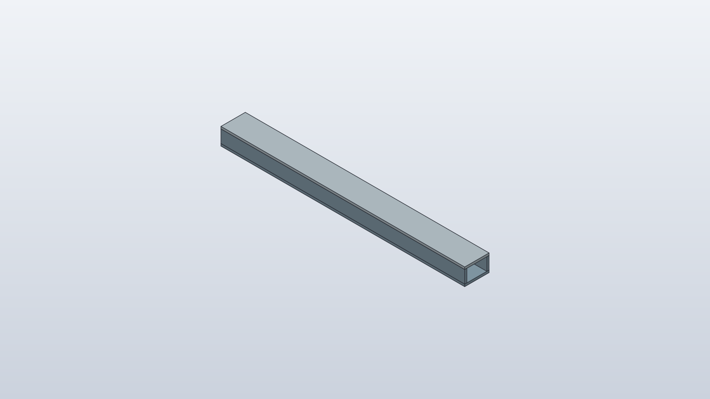
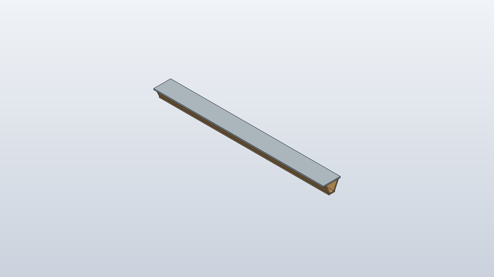
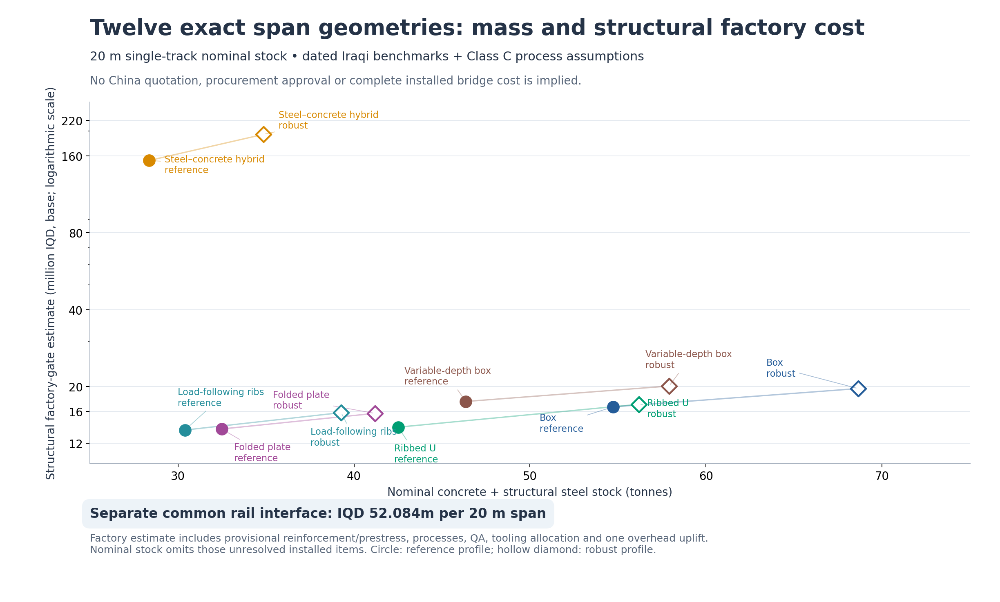
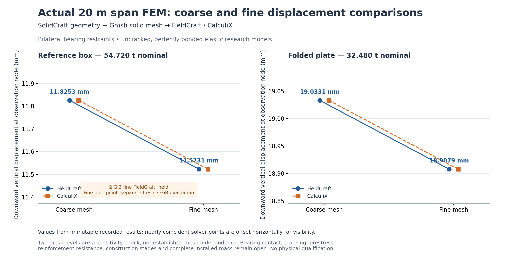

# Twelve 20 m viaduct outlines: CAD, mechanics and manufacturing

Twelve canonical span geometries across six structural families now pass through
one optional SolidCraft → mechanical-analysis → manufacturing/cost workflow.
All twelve have exact STEP geometry independently measured in FreeCAD; two have
matched coarse/fine FieldCraft and CalculiX solid-element results. The selected
railway baseline and default providers are unchanged.




These are unmodified native CAD snapshots, without display offsets. The downloadable
models retain separate material regions. The model named `reference_box` is the
**54.720 t four-wall portfolio geometry**, not the selected **55.704 t six-part
beam with end diaphragms**. Neither number is complete installed bridge mass.

## Compare and download



| Family / parameter profile | Nominal stock, t | Structural factory, IQD m | Scoped installed, IQD m | Native model / production route |
|---|---:|---:|---:|---|
| [reference box / reference](models/reference_box--reference/assembly.step) | 54.720 | 16.656 | 96.246 | [SC](models/reference_box--reference/assembly.sc) · [STL](models/reference_box--reference/assembly.stl) · [route](delivery/reference_box--reference.json) |
| [reference box / robust](models/reference_box--robust/assembly.step) | 68.645 | 19.641 | 99.528 | [SC](models/reference_box--robust/assembly.sc) · [STL](models/reference_box--robust/assembly.stl) · [route](delivery/reference_box--robust.json) |
| [ribbed u / reference](models/ribbed_u--reference/assembly.step) | 42.505 | 13.868 | 93.198 | [SC](models/ribbed_u--reference/assembly.sc) · [STL](models/ribbed_u--reference/assembly.stl) · [route](delivery/ribbed_u--reference.json) |
| [ribbed u / robust](models/ribbed_u--robust/assembly.step) | 56.185 | 17.044 | 96.666 | [SC](models/ribbed_u--robust/assembly.sc) · [STL](models/ribbed_u--robust/assembly.stl) · [route](delivery/ribbed_u--robust.json) |
| [variable depth box / reference](models/variable_depth_box--reference/assembly.step) | 46.354 | 17.482 | 96.895 | [SC](models/variable_depth_box--reference/assembly.sc) · [STL](models/variable_depth_box--reference/assembly.stl) · [route](delivery/variable_depth_box--reference.json) |
| [variable depth box / robust](models/variable_depth_box--robust/assembly.step) | 57.901 | 20.091 | 99.750 | [SC](models/variable_depth_box--robust/assembly.sc) · [STL](models/variable_depth_box--robust/assembly.stl) · [route](delivery/variable_depth_box--robust.json) |
| [folded plate / reference](models/folded_plate--reference/assembly.step) | 32.480 | 13.643 | 92.761 | [SC](models/folded_plate--reference/assembly.sc) · [STL](models/folded_plate--reference/assembly.stl) · [route](delivery/folded_plate--reference.json) |
| [folded plate / robust](models/folded_plate--robust/assembly.step) | 41.185 | 15.707 | 95.010 | [SC](models/folded_plate--robust/assembly.sc) · [STL](models/folded_plate--robust/assembly.stl) · [route](delivery/folded_plate--robust.json) |
| [hybrid steel concrete / reference](models/hybrid_steel_concrete--reference/assembly.step) | 28.368 | 153.496 | 232.513 | [SC](models/hybrid_steel_concrete--reference/assembly.sc) · [STL](models/hybrid_steel_concrete--reference/assembly.stl) · [route](delivery/hybrid_steel_concrete--reference.json) |
| [hybrid steel concrete / robust](models/hybrid_steel_concrete--robust/assembly.step) | 34.850 | 194.180 | 273.331 | [SC](models/hybrid_steel_concrete--robust/assembly.sc) · [STL](models/hybrid_steel_concrete--robust/assembly.stl) · [route](delivery/hybrid_steel_concrete--robust.json) |
| [load following ribs / reference](models/load_following_ribs--reference/assembly.step) | 30.391 | 13.514 | 92.587 | [SC](models/load_following_ribs--reference/assembly.sc) · [STL](models/load_following_ribs--reference/assembly.stl) · [route](delivery/load_following_ribs--reference.json) |
| [load following ribs / robust](models/load_following_ribs--robust/assembly.step) | 39.269 | 15.810 | 95.072 | [SC](models/load_following_ribs--robust/assembly.sc) · [STL](models/load_following_ribs--robust/assembly.stl) · [route](delivery/load_following_ribs--robust.json) |

[Comparison CSV](comparison.csv) · [Same-candidate records](cases.json) ·
[Full comparison and evidence IDs](summary.json) · [Provider interfaces](../../../engineering/design_search/craft_backends/backend_api.py).

**Cost basis:** retained dated Iraqi observations and Class C process proxies;
these are not newly researched Chinese quotations or revised city prices.
Low/base/high costs, quantities, proposed manufactured groups, process routes,
ownership and remaining allowances are in each route record. Nominal CAD regions
are not purchased-component counts: the concrete families propose a cast span;
the hybrid proposes one deck and two girders.

The common base rail/fastener allowance alone is **IQD 52.084m** per 20 m span.
The base support/foundation/bearing reserve is another **IQD 20m**. These accounts
are separated from structural factory cost. Replace matching corridor budget
owners rather than adding these span totals to already-priced rail, foundation
or erection accounts. Missing complete installed costs and masses remain unknown.
A 100-use mould assumption does not prove a committed batch, removable mould,
curing capacity or production schedule. The surface-area proxy is not a mould drawing.

## Actual structural comparison



The box gives 11.8253 → 11.5231 mm downward midspan displacement (2.623% change);
the folded plate gives 19.0331 → 18.9079 mm (0.662% change). Both satisfy this
experiment's declared equilibrium, displacement-refinement and cross-solver
screens. Two mesh levels do not establish mesh independence or physical resistance.

The original **2 GiB fine box FieldCraft solve failed allocation**. Its receipt
remains held. The fine plotted FieldCraft result belongs to a **separate 3 GiB
resource evaluation**, with the original geometry, load, mesh and material.
The folded-plate pair completes within the original 2 GiB limit.

SolidCraft STEP is imported and fragmented using **Gmsh 4.14.1 / OpenCASCADE**,
then meshed with conformal straight-sided quadratic tetrahedra. The FieldCraft
native hexahedral meshing attempt on these shared prism faces remains a recorded
failed probe. This result does not imply that path was fixed or used successfully.
Node ordering is converted explicitly for each solver. Positive Jacobian checks
are not a complete element aspect-ratio or dihedral-quality assessment.

The research material is homogeneous, uncracked concrete, E = 35 GPa, ν = 0.2,
ρ = 2500 kg/m³, with perfect bonding. A shared crowd-control axle pose and
candidate self-weight/declared non-CAD mass are applied; these are not an exhaustive
moving-load envelope. Four axles at x = 5.3, 7.4, 10.0 and 12.1 m each carry
99.510 kN, including the dynamic factor once, through two rail patches.

Finite **bilateral** restrained patches at both ends introduce fixture stiffness
and tensile nodal reactions. They are not verified bearings or compression-only
contact. Actual bearing compliance/contact, rail/support connections, cracking,
reinforcement, prestress, fatigue, torsion, temporary stability and lifting remain
open. The box lifting reserve already exceeds a nominal 60 t crane control;
crane capacity must be established at the required radius with verified lift points.
Sampled nodal stresses and CalculiX integration-point maxima have different scopes;
no agreement of full stress fields is claimed. No structure is approved for construction.

## Reproduce, revise and retain alternatives

```bash
./osr design backends providers
./osr design backends viaduct plan
# A fresh immutable campaign; bounded native work is explicit:
./osr design backends viaduct run --execute --output /path/to/private/fresh-run
./osr design backends viaduct verify --output /path/to/private/fresh-run
# Portable checks of this selected public dossier; no CAD/FEM installation needed:
./osr design backends viaduct verify-publication
```

The CAD provider exposes generate, revise, validate and export; the analysis
provider prepares, meshes, solves and verifies; delivery recalculates quantities,
routings, costs and disabled business drafts from the same physical definition.
A revision records ancestry and its reason. Candidate, evaluation and selection
identities remain separate. Unknown FEM performance never receives a zero score.
The retained Pareto archive compares nominal mass and scoped factory cost only.

The tested pair remains **SolidCraft 0.30.1 / FieldCraft 0.7.5**. The newer format
compatibility boundary is documented in the [initial pilot](../craft-backends/README.md).
FreeCAD/CalculiX remain independent comparisons; Gmsh/GetDP, IfcOpenShell/Bonsai,
Chrono and SUMO retain their specialist routes. This extends the existing
[detailed launch shuttle](../launch-detail/README.md), not a second design platform.

The native CAD generation plus independent measurement used 13 processes and
6.615 s in this bounded cohort. Subsequent STL export and two snapshots used
three more processes. All 29 FEM-process attempts, including failed/earlier source
epochs, remain retained privately; no generic solver-throughput claim follows.
The successful box fine solve reports 1.24 GiB peak RSS under a 3 GiB per-process
address-space limit. Thread limits are requested through environment variables;
hard CPU affinity and aggregate-memory cgroups are not enforced.

Strict historical mesh/load replay uses the original `/usr/bin/python3` NumPy
2.5.3 context; the coordinator environment has NumPy 2.3.5. Substituting one changes
last-bit nodal load identities and is rejected. The adapter now records the
chosen interpreter and NumPy/BLAS/LAPACK artifacts before and after replay.
Later observations of the historical Gmsh binary are not recast as original
pre-execution pins. The public records preserve these distinctions.

`manifest.json` inventories this compact selection. Original receipts under
`evidence/` remain unchanged; their paths and full inventories describe the
retained private runs. Public verification checks selected readbacks and derived
claims. It does not replay the omitted meshes, solver checkpoints or logs, and
performs no fresh solve. The original plotting script retains its private-run paths as historical provenance.
The portable [replot helper](presentation/render-recorded-plots.py) reads only
adjacent [plot data](presentation/plot-data.json); run it with `--output` pointing
to a fresh directory. Both regenerated plots match the recorded PNG bytes in the
recorded Matplotlib environment. Data and receipts retain source evaluation IDs. No selected baseline, manufacturing release, movement
authority or physical acceptance is granted.

Next: resolve bearing/contact behavior, develop reinforcement/anchorage and
removable mould details, test lift/erection stages, and replace the dominant cost
proxies with current scoped sourcing and production-capacity evidence.
