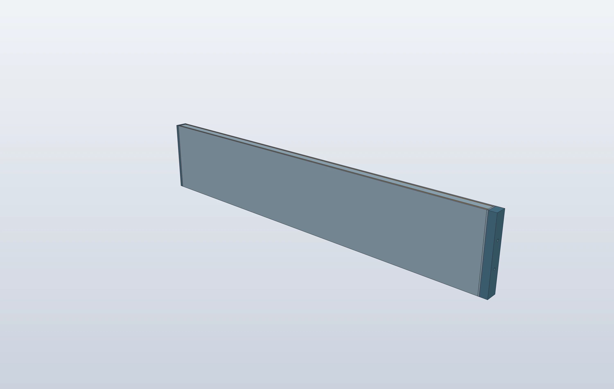
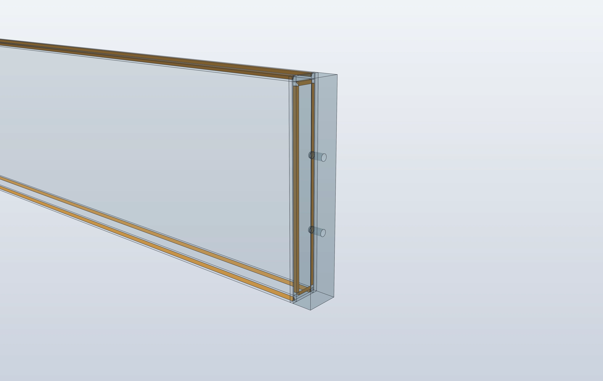
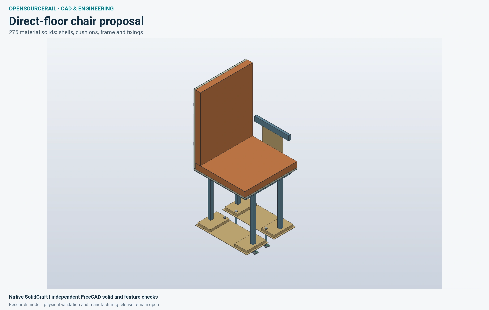
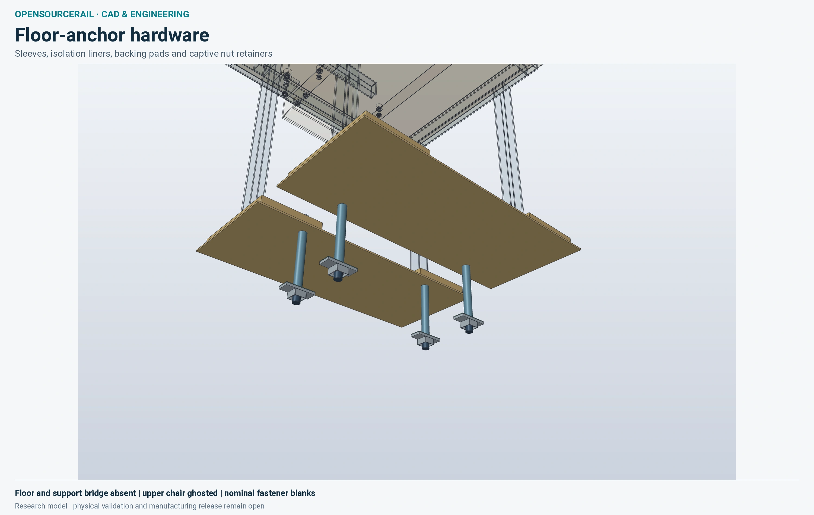
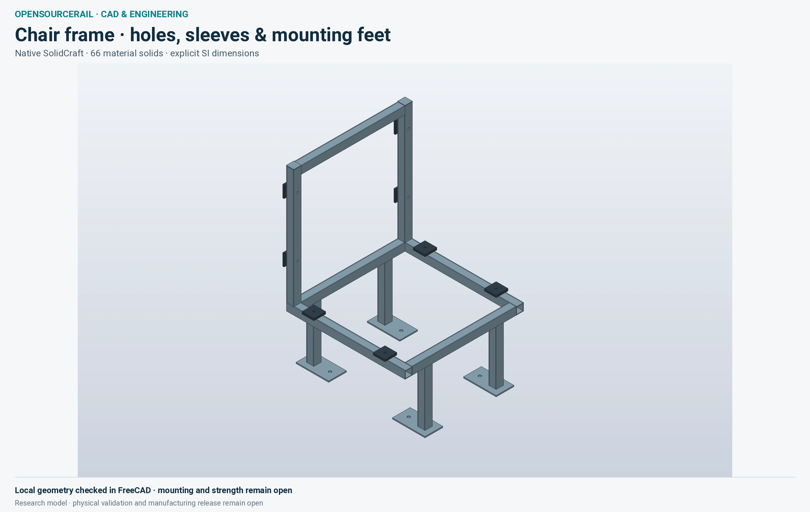
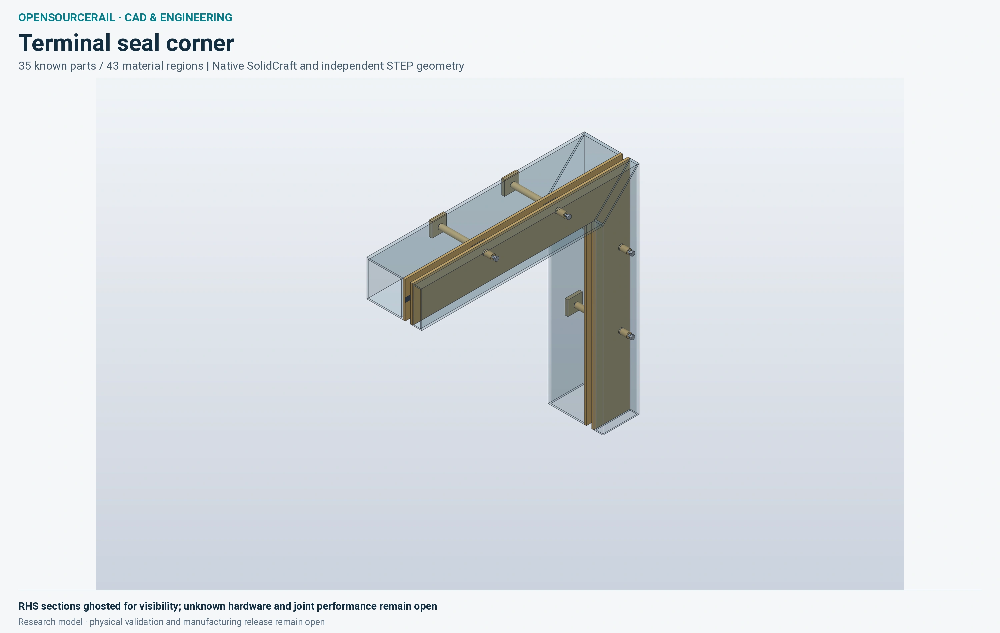
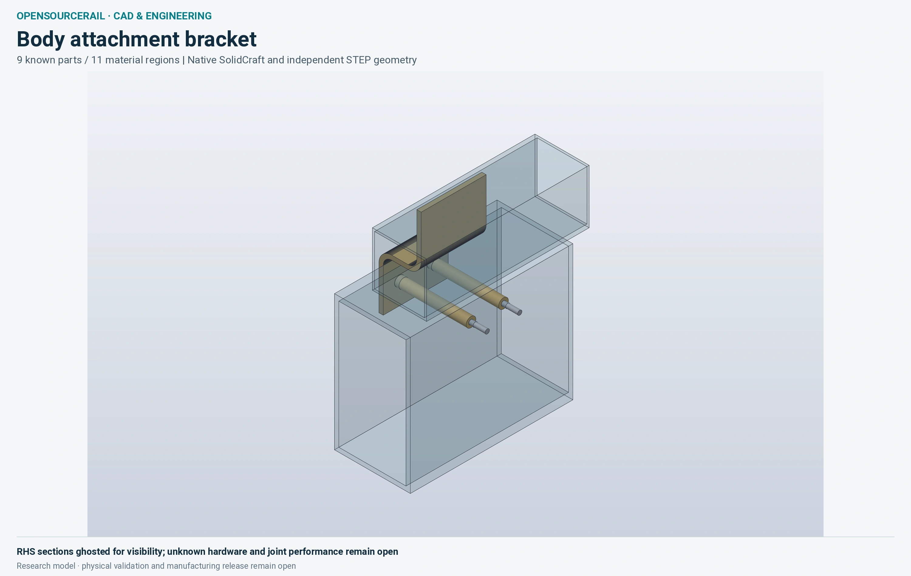

# CAD and FEM image gallery

The front-page gallery uses actual source geometry and native numerical output. The [manifest](assets/engineering-gallery-v06/manifest.json) records each physical candidate, input/evaluation identity, source SHA-256, rendering recipe, output SHA-256 and display transformation. It is a collection of separate research designs, not a selected whole-system assembly.

| View | Geometry and interpretation |
|---|---|
| [Vehicle cutaway](assets/engineering-gallery-v06/vehicle-car0.webp) | Located one-car stock/fitout from the [bogie-detail research body](design-engine/reconciled-pilot-bogie-detail/README.md). Blender renders existing source meshes; roof, high equipment and near-side wall omissions are recorded. Equipment envelopes are not finished supplier geometry. |
| [Bogie cradle](assets/engineering-gallery-v06/bogie-cradle.webp) | SolidCraft snapshot of the [34-solid stock subset](design-engine/powered-bogie-detail/README.md). No invented motor/gearbox housings. Complete bogie fit is held. |
| [Launch shuttle](assets/engineering-gallery-v06/launch-assembly.webp) and [clevis](assets/engineering-gallery-v06/launch-clevis.webp) | SolidCraft snapshots of the [122-region assembly](design-engine/launch-detail/README.md). Transparent/ghosted guards and surrounding stock expose real bores, pin, retainers and hollow members; the geometry itself is unchanged. |
| [Civil assembly](assets/engineering-gallery-v06/civil-assembly.webp) | Source-defined 265-entity two-track segment, rail, bearing, pier and footing proposal. Rendering this assembly does not analyse its joints, reinforcement or supports. |
| [Civil FEM](assets/engineering-gallery-v06/civil-fem.webp) | FieldCraft 0.7.5 full displacement field on the separate continuous gross elastic beam under the retained normal-base load. 22,680 tetra10 elements and 43,340 nodes. Each exterior quadratic face is split through its actual midside nodes; triangle colours average the native nodal displacement magnitudes. Deformation is exaggerated 100×; the legend is in millimetres. |

The FEM replay retained the exact binary mesh and reproduced the earlier **13.9476148427 mm** downward midspan vertical displacement (native Uᶻ = −0.0139476148427 m). Maximum displacement magnitude is **14.1132971464 mm**, which also includes horizontal movement. The coordinate exchange allows only the documented ten-decimal ASCII rounding, bounded by 5.1×10⁻¹¹ m; it does not change an engineering tolerance. The original rejected postprocessing attempt is preserved beside the corrected result.

This is a homogeneous elastic concrete model with ideal bearing lines. Cracking, prestress, segment joints, fatigue, contact, erection and physical qualification remain unresolved. The located assembly image must not inherit this continuous-beam result. Geometry agreement and numerical convergence do not grant manufacturing or operating approval.

## Terminal frame fabrication

| Fabricated member | End-joint detail |
|---|---|
| [](assets/terminal-frame-v06/frame.sc) | [](assets/terminal-frame-v06/frame.step) |

This local terminal side-frame proposal uses **four aluminium 5083 plates and two endplates**, with twelve finite weld-deposit regions. The hollow member is 635 × 20 × 120 mm; its endplates increase the overall length to 651 mm. Colour separates plates, endplates and filler for inspection; all use the same declared aluminium material. The close-up ghosts the plates without moving or enlarging any component.

| Physical piece | Quantity | Nominal finished stock |
|---|---:|---|
| Side plate | 2 | 635 × 120 × 3 mm, with joint-edge preparation |
| Top/bottom plate | 2 | 635 × 14 × 3 mm, with joint-edge preparation |
| Front endplate | 1 | 12 × 20 × 120 mm; two blind major/pilot bore envelopes |
| Rear endplate | 1 | 4 × 20 × 120 mm |

The four longitudinal grooves are 2 mm wide and 2 mm deep, with 2 mm runouts at each end. Each cap has four internal 2 mm fillet-deposit regions. Splitting each long plate into three contiguous CAD regions represents the finite runouts; it creates **no additional plate purchases or assembly joints**. The 26 CAD regions retain six existing stock-account owners, including the filler accounts. They are not 26 purchased components. Original paid blanks remain counted once.

SolidCraft 0.30.1 built and reopened the native and STEP files. FreeCAD 1.1.4 / OpenCASCADE 7.8.1 independently imported **26 valid, closed, positive single solids**, with a unique match by volume, centroid and bounds. All **416 finite material and void probes** agree. Maximum measured coordinate discrepancy was approximately 10⁻¹⁰ m. FreeCAD's literal source-name check remains **failed** because the importer renamed the solids; geometric matching does not repair that identity contract.

These are nominal research shapes. Cylindrical major/pilot envelopes do not constitute manufactured thread helices. Torch access and assembly sequence, weld procedure and penetration, tolerances, heat effects, loads, fatigue and full-vehicle fit remain unresolved. The local result does not validate the complete terminal, the other frame variants or the installed train. It also carries no complete train cost or manufacturing release.

Download [SolidCraft](assets/terminal-frame-v06/frame.sc), [STEP](assets/terminal-frame-v06/frame.step), [recorded commands](assets/terminal-frame-v06/commands.json), [source material regions](assets/terminal-frame-v06/case.json), [independent measurements](assets/terminal-frame-v06/FreeCAD.json), and the [evidence manifest](assets/terminal-frame-v06/manifest.json). The packet retains the source returns, original PNGs, cameras, native tool pin and independent reviews. Run the saved-data audit without a CAD tool:

The [review provenance clarification](assets/terminal-frame-review-note.json) distinguishes the final supplement's three explicit status checks from the original geometry-roster checks. Both review epochs and the original presentation-binding record remain preserved.

```bash
python3 docs/assets/terminal-frame-v06/verify.py
```

To regenerate the exact CAD with the [pinned SolidCraft executable](assets/terminal-frame-v06/tool-pin.json), use a fresh output directory:

```bash
mkdir /tmp/osr-terminal-frame
solidcraft-cli run docs/assets/terminal-frame-v06/commands.json \
  --save /tmp/osr-terminal-frame/frame.sc \
  --out /tmp/osr-terminal-frame/frame.step \
  --results --json-out /tmp/osr-terminal-frame/results.json
```

This replays the recorded geometry commands; a fresh verification or render must record its own tool, inputs and resource context.

## Revised direct-floor chair

| Chair and anchor coupon | Anchor underside |
|---|---|
| [](assets/chair-installation-r4-v06/chair.sc) | [](assets/chair-installation-r4-v06/chair.sc) |

This local R4 proposal contains **275 separate material solids**: aluminium frame and mounting plates, sandwich shells, foam/fabric covers, steel fixing blanks and insulating liners. Its four feet are 20 mm thick. Separate sleeves, backing pads, nut cages and soft bolt-tip caps represent the floor anchors. The [top view](assets/chair-installation-r4-v06/anchor-top.webp) shows the mounting plates and recessed strips. Colours and transparency are presentation choices; dimensions and positions are unchanged.

SolidCraft generated the model and reopened its native and STEP files. An independent FreeCAD 1.1.4 / OpenCASCADE 7.8.1 import has **275 positive, valid, closed solids**, uniquely matched by individual volume, centroid and bounds. All **2,427 finite material/void probes** agree, including blind-bore ends, annular sleeves and adjacent material. These are diagnostic samples, not proof of complete geometric equivalence. FreeCAD renamed the imported solids: the original strict name-identity check remains failed and is retained separately.

The mating structural floor and support bridge are **absent from this coupon**. The long anchor sleeves are shown exposed. Weld, finish, seam and sealant quantities remain separately bounded; they are not included as invented native solids. Purchased threads are nominal blanks, and tolerances, preload, installed clearance, structural loads, fatigue, fire behaviour and ergonomics still need their own checks. This exact local recipe has not been installed in the selected reference. Other mounting-row and handedness variants require applicable geometry and fit evidence; the image does not validate all train seats.

Download [SolidCraft](assets/chair-installation-r4-v06/chair.sc), [STEP](assets/chair-installation-r4-v06/chair.step), [recorded commands](assets/chair-installation-r4-v06/commands.json), [parts and stock definition](assets/chair-installation-r4-v06/source/coupon.json), [source recipe and material assumptions](assets/chair-installation-r4-v06/source/recipe.json), and the [evidence manifest](assets/chair-installation-r4-v06/manifest.json). The packet retains native outputs, exact STEP measurements, probe records, the explicitly instrumented measurement worker, original PNGs and all three camera/style recipes. The previous chair frame below remains available.

```bash
python3 docs/assets/chair-installation-r4-v06/verify.py
```

This read-only audit rechecks the saved source oracles, command serialization, original evidence hashes and recorded probe outcomes. It starts no CAD application or solver and grants no physical acceptance.

## Chair frame

[](assets/finished-chair-v06/chair.sc)

The proposed frame contains **66 separate material solids**, including hollow members, mounting feet, paired shell holes, crush sleeves and isolation pads. SolidCraft generated the model and reopened both its native file and STEP export. The independent FreeCAD import contains 66 valid, closed solids with the same individual volumes and bounds; their summed material volume is **0.000814637045 m³**. Weld beads, finish and purchased fastener shapes are separately accounted allowances.

FreeCAD renamed the imported parts. The original strict identity check therefore remains **failed**. A separate readback records 66 unique geometric matches using the original volume and bounds tolerances; this establishes geometry correspondence, without claiming persistent imported names. Mounting lands, access, seat-height reconciliation, strength, fatigue and fire qualification remain open. This local part is not installed in the selected reference. The original sibling terminal-seal proposal's failed compression screen is retained; the separate, more detailed joint below does not erase that result.

Download [SolidCraft](assets/finished-chair-v06/chair.sc), [STEP](assets/finished-chair-v06/chair.step), [recorded commands](assets/finished-chair-v06/commands.json), [exact geometry correspondence](assets/finished-chair-v06/geometry-reassessment.json) and the [evidence manifest](assets/finished-chair-v06/manifest.json). The 3000×1900 image is a native SolidCraft snapshot of that saved model. The packet retains the failed strict import result alongside the geometry comparison; rendering changes no physical geometry or acceptance.

Audit the retained files and geometric correspondence with `python3 docs/assets/finished-chair-v06/verify.py`. This reads existing results and starts no CAD application or solver.

## Terminal joint coupons

| Terminal seal corner | Body attachment bracket |
|---|---|
| [](assets/terminal-parts-v06/corner.sc) | [](assets/terminal-parts-v06/bracket.sc) |

These are two local research assemblies from the [terminal joint definition](../engineering/terminal_enclosure_joint.py). The corner represents **35 known parts as 43 material solids**; the bracket represents **nine known parts as 11 material solids**. A nominal bolt shank and head can occupy separate solids. Surrounding hollow sections are ghosted for visibility; material colours are display choices.

SolidCraft generated both models and reopened their native and STEP files. Independent FreeCAD imports contain **54 valid, closed solids**, with unique correspondence by individual volume, centroid and bounds. Imported names failed the original strict check in both cases; the unchanged failure records accompany the separate geometry comparison. The first native attempt also remains recorded: a duplicate arc point differing by one floating-point step produced a zero-length line. The corrected serializer removes only the registered duplicate points, reproduces the original nominal geometric oracles and moves no finite feature.

The views exclude **12 unknown corner entities**, **eight unknown bracket entities**, and the corner's free, uncompressed gasket. Purchased threads, sealing response, tolerances, preload, joint strength, fatigue, fire behaviour and complete installed fit remain open. Individual-solid agreement is not an assembly interference check. The surrounding test-piece volumes are not additional installed vehicle stock. These local definitions have not been installed in the selected reference or priced as a complete vehicle.

Download the corner's [SolidCraft](assets/terminal-parts-v06/corner.sc), [STEP](assets/terminal-parts-v06/corner.step) and [commands](assets/terminal-parts-v06/corner.commands.json), or the bracket's [SolidCraft](assets/terminal-parts-v06/bracket.sc), [STEP](assets/terminal-parts-v06/bracket.step) and [commands](assets/terminal-parts-v06/bracket.commands.json). The [manifest](assets/terminal-parts-v06/manifest.json) binds the source geometry, analytical oracles, native executions, independent checks, original PNGs and image composition recipes. Both images retain the native camera view without cropping or stretching.

```bash
python3 docs/assets/terminal-parts-v06/verify.py
```

This read-only audit reproduces the source oracles and command serialization, checks the retained geometry results and preserves the failed name checks. It starts no CAD application or solver.

## Inspect and reproduce

The packet includes original CAD PNGs, exact recipes/cameras/styles, native execution receipts, the full native VTU export compressed losslessly, the original mesh, a compact nodal field and figure metadata. The larger results-embedded FieldCraft project remains retained in the original private execution package; the public VTU is sufficient to regenerate the figure without solving again.

The current vehicle PNG was rendered from the exact current door-motion installation input in 472.60 seconds; its source remained unchanged and the render completed. Blender measured 4,037,616 KiB (3.85 GiB) peak worker RSS, above the 3 GiB target; the Flatpak supervisor measured 18,648 KiB. The memory target was not met. The earlier 603.36-second held render and its missing supervisor measurement remain in the prior publication and run record. The current image is presentation evidence only and does not qualify the installation.

From the repository root:

```bash
.venv/bin/python -m tools.engineering_gallery.publication verify
.venv/bin/python -m tools.engineering_gallery.publication replot docs/assets/engineering-gallery-v06 /tmp/osr-civil-field.png
```

The second command reconstructs the existing full-field figure; it does not start a solver. Use a fresh output filename. To rerender an eligible CAD view with the pinned SolidCraft or installed Blender backend, record a fresh private run:

```bash
.venv/bin/python -m tools.engineering_gallery.cad launch-assembly --output /tmp/osr-launch-render
```

Native SolidCraft camera targets/distances are explicitly in millimetres and camera angles in radians; source assembly geometry uses metres. Native CAD runs use the recorded read-only/network-isolated wrapper and CPU/address-space limits. Blender receipts report in-worker memory separately from the Flatpak supervisor and use four rendering threads; they are observed resource records, not an aggregate OS memory sandbox. The coordinator itself has unrestricted workspace access. Render-only colours, cameras and omissions do not change CAD, mass, selection or acceptance.
