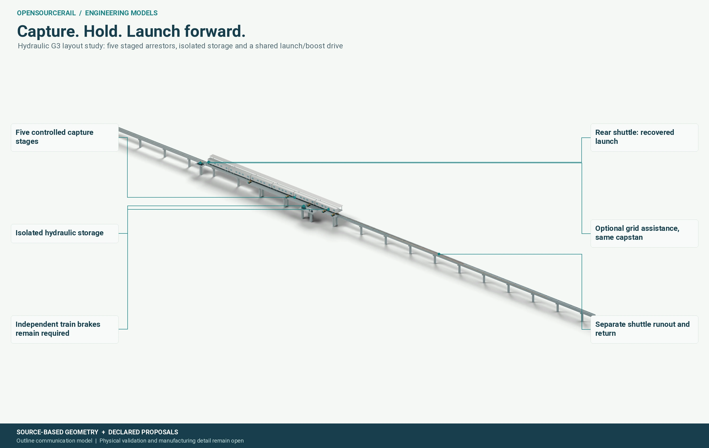
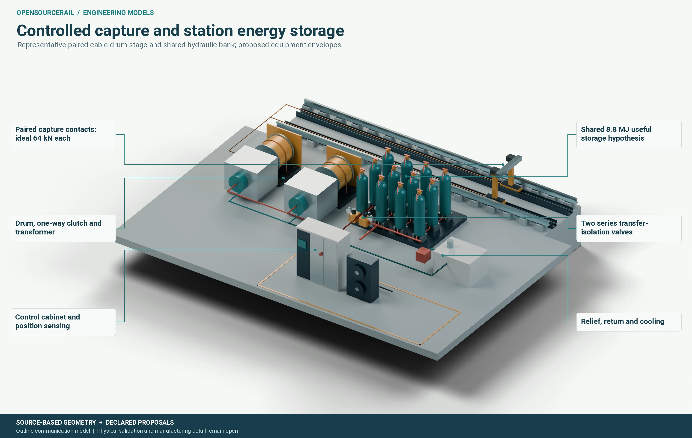
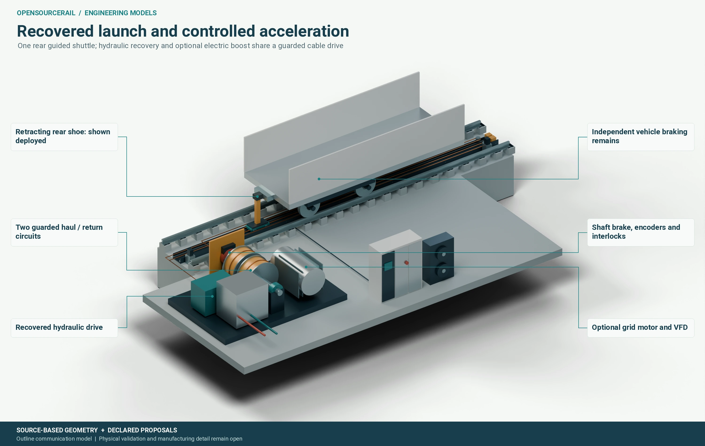
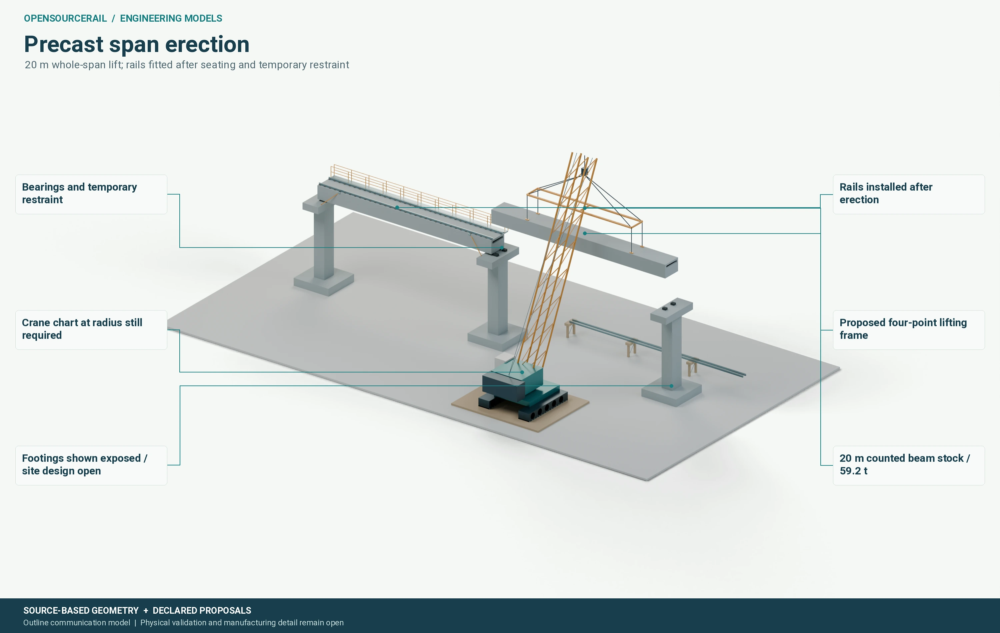
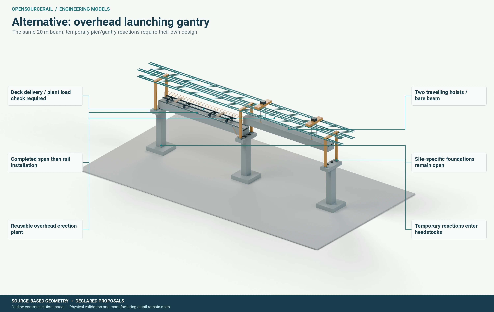
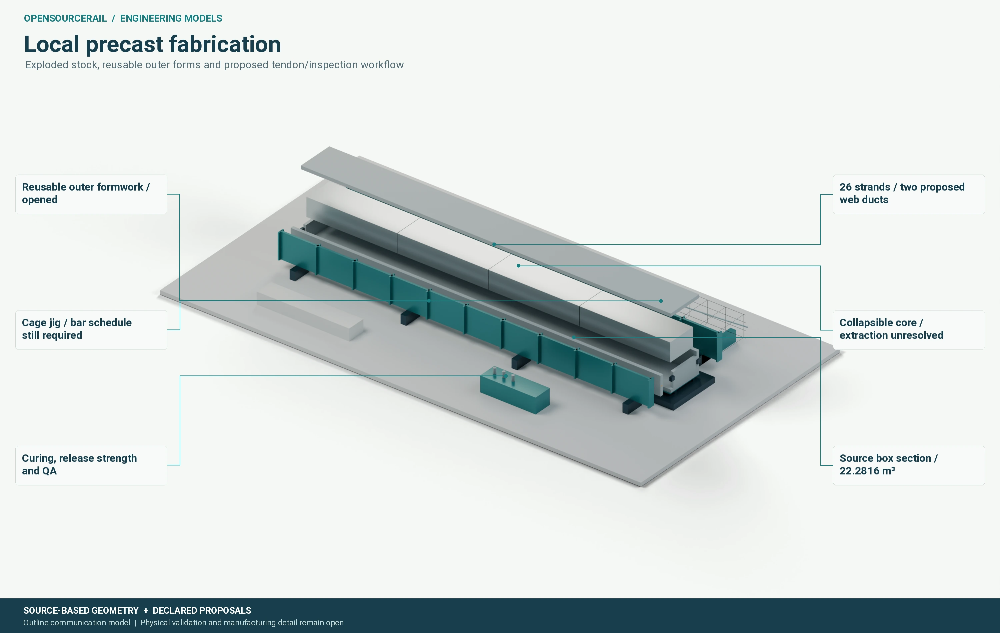
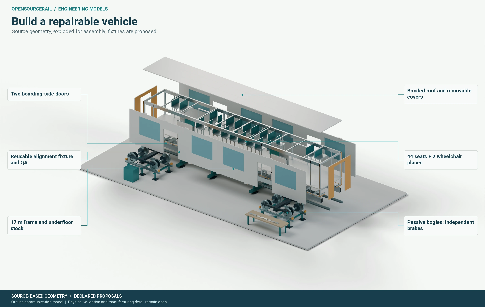
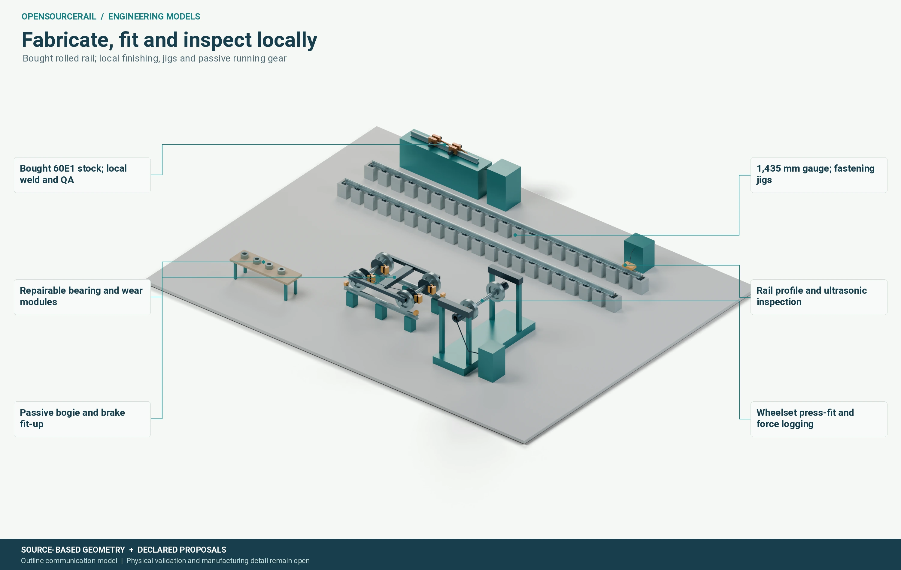

# Engineering models

[Project introduction](../../README.md) · [Current engineering](../design-engine/current/README.md)

These are parametric 3D assemblies rendered from the same explicit geometry that is exported to CAD. They explain the station mechanisms, construction and fabrication routes. Dimensions copied from the current vehicle and beam are distinguished from proposed equipment envelopes and shop tooling.

**Use:** compare layouts, inspect parts and discuss manufacturing. These are outline communication models; they are not released drawings, a lifting plan, a pressure-vessel design or an operating system. The selected railway and its qualification status are unchanged.

## Station capture, storage and launch

The illustrated research layout uses five staged cable arrestors, a hydraulic energy store and a controlled rear launch shuttle driven by a common capstan. Stored energy supplies the first part of departure; an optional motor supplies the remaining acceleration. Independent train braking, energy isolation, mechanical retention, guards, sensing, wiring and maintenance access are shown separately.

The source control uses a **160 t effective point mass**, arrival capture from **10 m/s** and a **60 km/h** departure study. Its calculated capture travel is **70.5 m**; recovered launch travel is **43.35 m**, followed by **128.94 m** of boosted travel. These are train-motion distances, not validated equipment lengths. The 8.8 MJ store requirement and proposed vessel envelopes do not establish pressure containment, installed storage mass or achievable performance. Neither this mechanism nor its speed is a mandatory design choice.

The source six-car formation occupies **104.5 m**, including five 0.5 m coupling gaps. Local close-up coordinates are declared in each recipe. The launch view includes a separate proposed shuttle runout; coupling loads, cart disengagement, train compression, jerk and failure behaviour require analysis.

## Construction and fabrication

- **Whole-span crane erection:** surveyed supports and bearings, delivery trailer, crawler crane, spreader and temporary restraint. The source bare lifting stock is about **59.18 t**, excluding rigging and unresolved attachments. Crane capacity, working radius, ground bearing and temporary stability must be engineered for the site.
- **Overhead gantry alternative:** deliver and lower the same 20 m span from a launching gantry. This is an alternative erection scheme; its steelwork, support reactions and launch sequence are proposals. The illustrated seats give a proposed 19.4 m bearing-centre spacing beneath 20 m stock; the source 20 m analytical result is not inherited by that layout.
- **Precasting:** reusable outer forms, a proposed collapsible core, cage jig, two proposed tendon ducts and inspection specimens. The six disjoint source concrete solids total **22.2816 m³**. The core extraction, bar schedule, tendon/anchorage detailing, curing and release strength remain to be designed.
- **Vehicle assembly:** all **2,482 located source parts** are preserved, including drilled floor panels. Their **9,131.80 kg** is located stock, not the complete car tare. Render-only explosion separates roof, seating, covers, doors and bogies; downloadable geometry retains source positions.
- **Rails and running gear:** purchase standard rolled rail, then finish, join, inspect and fasten locally; assemble and inspect wheelsets, bearings and passive bogies. Tooling is proposed. The 60E1 display contour follows a manufacturer drawing and nominal dimensions; its approximate area is not a qualified rolling/contact profile or a replacement for the nominal rail mass.

An outline wheelset route is: receive traceable wheel/axle stock; finish and inspect interfaces; record the specified press-fit operation; inspect the assembled wheelset; mount bearings/axleboxes; then check the bogie and brake installation. [Lucchini’s production sequence](https://lucchinirs.com/divisions/railway-division/railway-products/wheelsets/) and [GHH-BONATRANS inspection and maintenance scope](https://www.ghhbonatrans.com/en/products-and-services/service/) provide industrial context. The displayed press, gauges and inspection positions are proposals, not qualified machines or process specifications. Two 8-hour factory/civil shifts remain planning inputs; a workstation picture does not establish cycle time or annual capacity.

## Inspect and download

STL opens in GitHub’s 3D viewer. GLB keeps colours and part metadata; FCStd is the native FreeCAD solid assembly grouped by subsystem, with part IDs and SI recipes. Display colours are separate from source material tags; neither is a material certificate. STEP is gzip-compressed: decompress before opening it in CAD. **GLB uses metres; STL, STEP and FCStd use millimetres.** No presentation explosion is applied to downloaded models.

### Capture. Hold. Launch forward.



[Rotate STL](models/station-overview.stl) · [Coloured GLB](models/station-overview.glb) · [FreeCAD solids](models/station-overview.FCStd) · [STEP solids (.gz)](models/station-overview.step.gz) · [Exact recipe (.json.gz)](definitions/station-overview.json.gz)

### Controlled capture and station energy storage



[Rotate STL](models/arrestor-storage.stl) · [Coloured GLB](models/arrestor-storage.glb) · [FreeCAD solids](models/arrestor-storage.FCStd) · [STEP solids (.gz)](models/arrestor-storage.step.gz) · [Exact recipe (.json.gz)](definitions/arrestor-storage.json.gz)

### Recovered launch and controlled acceleration



[Rotate STL](models/launcher-booster.stl) · [Coloured GLB](models/launcher-booster.glb) · [FreeCAD solids](models/launcher-booster.FCStd) · [STEP solids (.gz)](models/launcher-booster.step.gz) · [Exact recipe (.json.gz)](definitions/launcher-booster.json.gz)

### Precast span erection



[Rotate STL](models/viaduct-crane.stl) · [Coloured GLB](models/viaduct-crane.glb) · [FreeCAD solids](models/viaduct-crane.FCStd) · [STEP solids (.gz)](models/viaduct-crane.step.gz) · [Exact recipe (.json.gz)](definitions/viaduct-crane.json.gz)

### Alternative: overhead launching gantry



[Rotate STL](models/viaduct-gantry.stl) · [Coloured GLB](models/viaduct-gantry.glb) · [FreeCAD solids](models/viaduct-gantry.FCStd) · [STEP solids (.gz)](models/viaduct-gantry.step.gz) · [Exact recipe (.json.gz)](definitions/viaduct-gantry.json.gz)

### Local precast fabrication



[Rotate STL](models/precast-fabrication.stl) · [Coloured GLB](models/precast-fabrication.glb) · [FreeCAD solids](models/precast-fabrication.FCStd) · [STEP solids (.gz)](models/precast-fabrication.step.gz) · [Exact recipe (.json.gz)](definitions/precast-fabrication.json.gz)

### Build a repairable vehicle



[Rotate STL](models/vehicle-fabrication.stl) · [Coloured GLB](models/vehicle-fabrication.glb) · [FreeCAD solids](models/vehicle-fabrication.FCStd) · [STEP solids (.gz)](models/vehicle-fabrication.step.gz) · [Exact recipe (.json.gz)](definitions/vehicle-fabrication.json.gz)

### Fabricate, fit and inspect locally



[Rotate STL](models/rail-running-gear.stl) · [Coloured GLB](models/rail-running-gear.glb) · [FreeCAD solids](models/rail-running-gear.FCStd) · [STEP solids (.gz)](models/rail-running-gear.step.gz) · [Exact recipe (.json.gz)](definitions/rail-running-gear.json.gz)

## Sources, checks and reproduction

The [manifest](manifest.json) binds each visual-study identity to source files, geometry recipes, native execution receipts and output hashes. Visual-study identities are separate from physical candidate, selection and evaluation identities. The station mechanism is a new layout proposal; it does not inherit engineering acceptance or the installed price of its source motion example.

The [source snapshot](source-snapshot.zip) preserves the exact producer and input epoch. Verification replays that snapshot and checks its vehicle geometry against the current reference. A price or unrelated evaluator update does not require rendering unchanged geometry again. Native workers are re-executed only when explicitly requested; stored receipts are not new physical evidence.

FreeCAD exports were reopened as both FCStd and STEP. Every native shape was checked for validity and positive volume; source primitives were compared with analytical volumes. GLB was imported again to check all part IDs and bounds. Binary STL was read back to check scale and bounds. These are digital integrity checks, not structural, manufacturing or safety validation. Summed solid volumes include tooling and overlapping equipment envelopes and are not installed material takeoffs.

Primary references: [FHWA prefabricated bridge assembly](https://www.fhwa.dot.gov/bridge/prefab/if09010/01a.cfm), [Caltrans construction guidance](https://dot.ca.gov/-/media/dot-media/programs/engineering/documents/structureconstruction/rcm/sc-rcm-compiled.pdf), [Freyssinet erection methods](https://www.freyssinet.com/solution/build/bridge-deck-construction/precast-segmental-erection/), [voestalpine 60E1 drawing](https://www.voestalpine.com/highperformancemetals/argentina/app/uploads/sites/264/2024/09/voestalpine-60E1.pdf) and [ArcelorMittal nominal rail data](https://rails.arcelormittal.com/profiles/transport-rails/european-standards/). They support the methods and reference dimensions; none approves these proposed assemblies.

The editable generators are in [`engineering/visual_models/`](../../engineering/visual_models/). Blender 5.2 and FreeCAD 1.1 were used through their installed Flatpak applications. Pillow and Roboto fonts compose the callouts. Runs use four Blender CPU threads and one native CAD thread. Raw images, logs and intermediate source snapshots stay in ignored `build/` directories.

```bash
python -m engineering.visual_models definitions --output build/model-definitions
python -m engineering.visual_models render --definitions build/model-definitions \
+  --assembly arrestor-storage --output build/model-run/render/arrestor-storage
python -m engineering.visual_models cad --definitions build/model-definitions \
+  --assembly arrestor-storage --output build/model-run/cad/arrestor-storage
# Repeat render and cad for the eight IDs in model-definitions/manifest.json.
python -m engineering.visual_models.publication publish --definitions build/model-definitions \
+  --runs build/model-run --output build/model-publication
python -m engineering.visual_models.publication verify --output build/model-publication
```

Publishing requires fresh output paths and all eight completed runs. Native workers execute as ordinary user processes; source hashes and before/after checks detect drift, but are not an OS sandbox or independent authenticated measurements.
