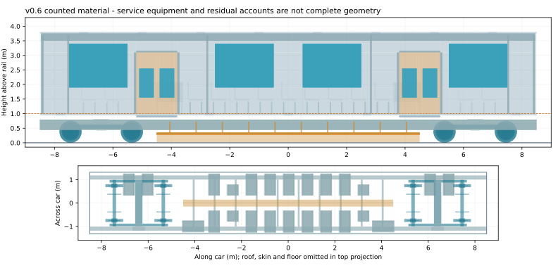

# OpenSourceRail: open railway design and delivery

OpenSourceRail aims to retain design authority, manufacturing, software, integration
and maintenance capability in-country. It connects three products: a design and
delivery platform, reference railway hardware and factories, and open GoA4 controls.
Low whole-life cost, local value added, repairability and repeatable construction
are objectives, not established savings.

## The v0.6 reference

The selected research configuration is **station-powered freewheeling wheel rail**.
It has 6 cars of 17 m, each with 44 fixed seats and
2 wheelchair places, and no planned standing. Passive bogies run on
conventional rails carried by precast concrete. Station double-sided LIMs act on
passive onboard aluminium secondaries; normal-service traction motors, traction
batteries and suspension magnets are absent from the train.

The targets are 72 km/h, 120-second headway and
35-second dwell. Capacity arithmetic gives 8,280
passengers/hour/direction, not a demonstrated protected service. Auxiliary batteries,
HVAC, doors, independent brakes, onboard ATP, station-led supervision and recovery
remain necessary. Passengers transfer between fixed lines; depot switching is a
separate exception to the no-mainline-switch policy.

*Partial stock geometry and equipment accounts, not a complete installed or approved train.*

## The wider platform remains

The lifecycle is plan, design, procure, manufacture, construct, commission, operate,
maintain and renew. [ERPNext/Frappe HR](../deployment/erpnext/README.md) retains
business, workforce, procurement, quality and maintenance functions.
[FUXA and the gateway](../deployment/supervision/README.md) retain observations,
alarms, history and review-linked lifecycle records. The
[planning workspace](workbench/planning/index.html) retains local city/service
editing and exports over historical packets; its v0.6 compilation is unconnected.
These services require configured roles, masters, device bindings and reviewed
imports; the engineering Workbench does not automatically commission them.

The [coordinated design experiment](design-engine/coupled-railway/README.md)
propagates revised bodies through inventory, interfaces, propulsion demand,
braking, civil loads and manufacturing/economic coverage. CAD/IFC stock,
EBOM/MBOM and assembly/procurement records share candidate identities. ERPNext
exports are disabled research drafts. Complete installed equipment, available
operating motor maps, force-driven journeys and whole-life prices remain open.

All 266 retained city geographies remain inputs. **v0.6 performance regeneration
is held**; earlier fleets, budgets and winding lengths are not current results.
Imported inputs retain their actual origin. No local-content percentage or
economic superiority is inferred from a lightweight material subtotal.

## Start and inspect

Run `./install.sh`, then `./osr workbench`. Use `./osr design railway plan` for
coordinated research, `./osr build` to refresh current evidence and `./osr verify`
to check its sources and payloads. `./osr sim baghdad` reports the city hold.

[Project introduction](../README.md) · [Current engineering](design-engine/current/README.md) ·
[Adoption path](first-adoptable-product.md) · [Architecture](ARCHITECTURE.md) ·
[Roadmap](ROADMAP.md) · [Reader](../OpenSourceRail-Book.pdf) · [Contribute](../CONTRIBUTING.md).

The [v0.4 introduction](https://github.com/modernecotech/OpenSourceRail/blob/205e8dc158c83fcdc2dca9ceb8bad0a7e8b3f61e/README.md)
and [v0.5 archive](archives/v0.5-maglev/README.md) retain earlier platform and
engineering detail. Historical examples, numerical methods and business closure
do not provide current physical, manufacturing or operating acceptance.

Software: Apache 2.0. Open physical designs: CERN-OHL-S v2. Documentation: CC-BY-SA 4.0.
See [licensing](../LICENSE.md) for the applicable path and upstream terms.

<!-- Generated by tools/automation/generate-public-overview.py; do not hand-edit. -->
