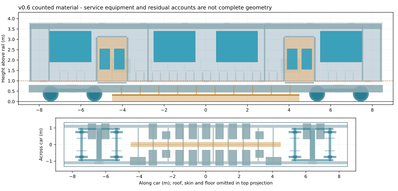
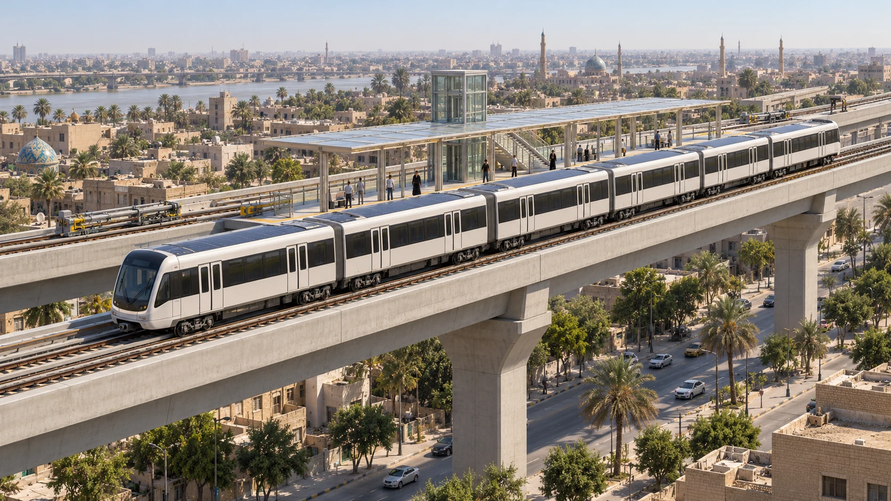
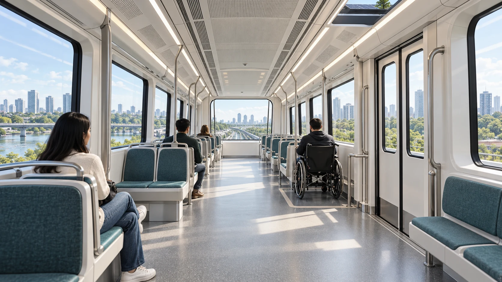
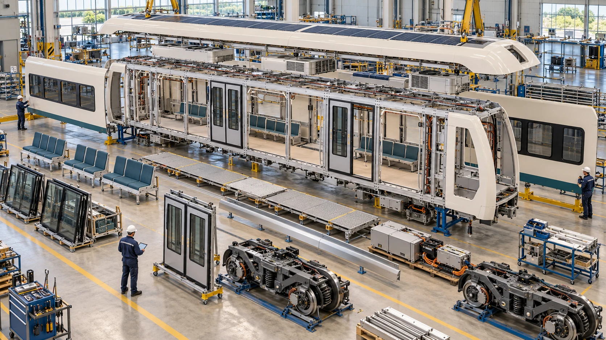
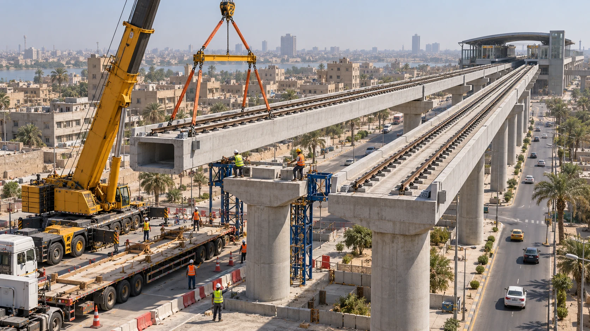
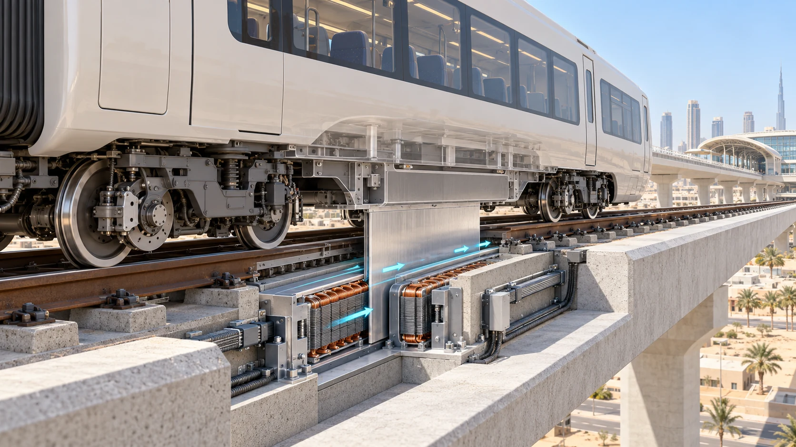

# OpenSourceRail: open railway design and delivery

OpenSourceRail connects city planning, railway engineering, manufacturing,
construction, business workflows and open train-control software. Its purpose is
to build local design authority, production and repair capability while
comparing whole-life cost and passenger service. These are project objectives;
economic superiority and physical qualification have not been demonstrated.

## Published v0.7.2 and current Baghdad review

The [v0.7.2 Baghdad Airport release](releases/v0.7.2/README.md) joins a
12 km, six-stop schematic, a 15-minute opening timetable, a six-set fleet,
radial traction supply, a supplier dossier and a 2026 USD planning estimate.
Its 2,800 normal places/hour/direction and $1,122.8 million central opening
capital belong to that released configuration. Site surveys, equipment returns,
physical tests and an owner decision remain necessary before construction or
passenger service.

Current main-branch work tests a [revised 17.46 km horizontal Airport route](../cities/Baghdad/engineering/simulation/AUDIT-RESULTS.md).
The 30-minute paired-supply replay completes 72 of 72 booked trips under its
declared model. Both evaluated supply layouts fail engineering screens, and
Um Al Tubol still needs a site. The paired-supply budgetary enquiry is tied to
that revised evaluation. The [later first-article prototype](../cities/Baghdad/engineering/prototype/README.md)
retains revised car and workshop records on the *earlier 12 km schematic*;
its drawings and $1.124 billion radial-layout estimate do not become the
17.46 km enquiry. [Baghdad design and cost guide](../cities/Baghdad/README.md)

The separate [v0.7 synthetic 30 km digital railway](reference-v07/README.md)
has a powered-wheel vehicle, overhead traction supply, a candidate-linked
beam, factory plan and fourteen-scope cost estimate. It is a comparison
reference, not a Baghdad route or a physical approval. The
[engineering status](ENGINEERING-STATUS.md) keeps these configurations and
their remaining decisions separate.

## Retained v0.6 development vehicle

The selected development vehicle reference has
6 cars of 17 m. Each car is planned for
44 fixed seats and
2 wheelchair places, with no planned
standing. Passive steel-wheel bogies run on conventional rails carried by
concrete guideway. The retained passive aluminium secondary is an interface
reference; it does not select installed station LIM propulsion. The reference
vehicle has no normal-service traction motor, traction battery or permanent
magnet. Independent braking, service power, protection and rescue remain required.

Installed propulsion architecture, powered length, acceleration, braking and
headway must be evaluated together for each candidate. Neither 900 m nor 100 m
is a prescribed installation. The named retained service control uses
72 km/h launch speed,
120 seconds headway and 35 seconds dwell;
these are reproducibility controls, not selected operating requirements. Its
8,280 passengers/hour/direction is
capacity arithmetic, not a demonstrated protected service. The selected vehicle
is a development reference without manufacturing or passenger-operation release.

Reference and alternative describe selection and comparison roles. Evaluated
results retain their declared calculation and evidence scope. Prototype
validation and release require separate physical evidence and review.



*Partial stock geometry and equipment accounts; not a complete installed or approved train.*

## Concept illustrations

These v0.6 illustrations show the intended passenger experience, local assembly and
construction approach. They are concept artwork. Detailed dimensions,
accessibility, equipment placement and construction methods require controlled
engineering records; the images do not establish physical performance.

### Elevated train and station



A wheel-supported train on conventional rails beside an elevated station, with roof solar panels and a platform canopy.

### Accessible passenger interior



A bright seated cabin with a wheelchair space beside the doors. Detailed seat counts, boarding clearances and restraints require the controlled layout.

### Local vehicle assembly



Workshop assembly concept showing the body, roof, glazing, doors, seating and bogies as separate assemblies.

### Precast guideway construction



Illustrated precast-beam erection above an urban corridor. Lifting arrangements, temporary stability and site protection need their own engineered plans.

### Station LIM alternative and passive secondary



This station LIM alternative shows passive wheel bogies and station-side double-sided primaries acting on a passive aluminium fin. Blue arrows illustrate the propulsion concept; no installed propulsion architecture or powered length is selected.

## Planning, engineering and delivery

Use the [current city catalogue](../cities/catalogue/README.md) and
[planning workspace](workbench/planning/index.html) to inspect candidate
routes, access, service and costs. The current coordinated search starts with
`./osr design railway`, [the coupled campaign](../campaigns/coupled-railway-design.toml)
and its candidate-specific evidence. Alternative architectures use their own
physical, evaluation and selection identities. The source-bound public
records support comparison and enquiry, not automatic engineering admission.

The following v0.6 planning and factory example remains a development
workflow for the selected passive-wheel vehicle. Its quantities and costs do
not carry over to the Airport or v0.7 powered-wheel candidates.

The [planning workspace](workbench/planning/index.html) verifies city
geography and route sources, then supports route, stop, service and OD proposals.
Run `./osr plan compile edits.json --output build/my-plan` to create an immutable
handoff bound to the selected candidate; run `./osr plan verify build/my-plan`
to verify its source files and identities. The handoff contains proposals only.
It excludes vehicle, propulsion, fleet, civil quantity, cost, performance and
cashflow results; those require candidate-specific evaluation. Planning
revisions do not grant movement authority.

From a verified handoff, create an immutable six-car factory work package
with:

```sh
./osr twin factory-draft compile build/planning-handoff --output build/factory-plan
./osr twin factory-draft verify build/planning-handoff build/factory-plan
```

The draft uses the selected candidate's Class C cost ledger and source-linked
low/base/high process hours under two 8-hour production shifts. It schedules one
serialized planning lane and does not infer crew size, parallel capacity or
calendar dates. Civil and railway-operations schedules, purchasing and
manufacturing release remain held.

The [coordinated design workflow](design-engine/coupled-railway/README.md)
propagates one candidate through geometry, mass, engineering analysis, BOM,
CAD/IFC, manufacturing, procurement, construction and controls. The
[current export manifest](design-engine/current/exports/manifest.json) and
[delivery package index](design-engine/coupled-railway/delivery-index.json)
bind research records to candidate identities. ERPNext exports are disabled
drafts. Complete installed equipment, an available operating motor map,
force-driven journeys and fully supported lifecycle costs remain open.

## Business and operating software

[ERPNext and Frappe HR](../deployment/erpnext/README.md) support draft business,
workforce, procurement, manufacturing, quality and maintenance workflows.
[FUXA and the gateway](../deployment/supervision/README.md) support equipment
observations, alarms, history and review-linked records. Site masters,
permissions, device bindings and reviewed imports require deployment-specific
configuration. These services do not commission a railway or supply movement
authority.

Cost scenarios use two 8-hour shifts for production and civil work. Operations
are modelled at two shifts for 16/18-hour service and three shifts for a 24-hour
case. These are planning assumptions, not approved staffing or operating plans.

## Start here

Run `./install.sh`, then `./osr status` and `./osr workbench`. Use
`./osr design railway` for coordinated candidate research and the commands
in each named packet to reproduce its declared evaluation. `./osr verify`
checks available source-bound publications; it does not qualify hardware.

[Project introduction](../README.md) · [Baghdad current audit](../cities/Baghdad/engineering/simulation/AUDIT-RESULTS.md) ·
[v0.7.2 release](releases/v0.7.2/README.md) · [v0.6 reference](design-engine/current/README.md) ·
[Architecture](ARCHITECTURE.md) · [Roadmap](ROADMAP.md) ·
[Candidate delivery](design-engine/coupled-railway/delivery-index.json) ·
[Reader](../OpenSourceRail-Book.pdf) · [Contribute](../CONTRIBUTING.md).

Software: Apache 2.0. Open physical designs: CERN-OHL-S v2. Documentation: CC-BY-SA 4.0.
See [licensing](../LICENSE.md) for the applicable path and upstream terms.

<!-- Generated by tools/automation/generate-public-overview.py; do not hand-edit. -->
