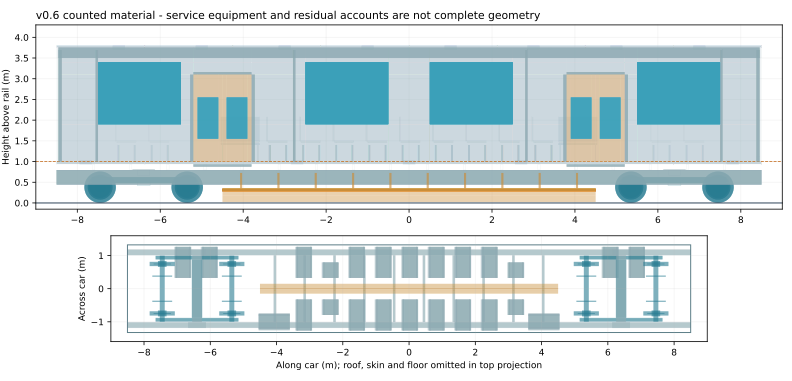
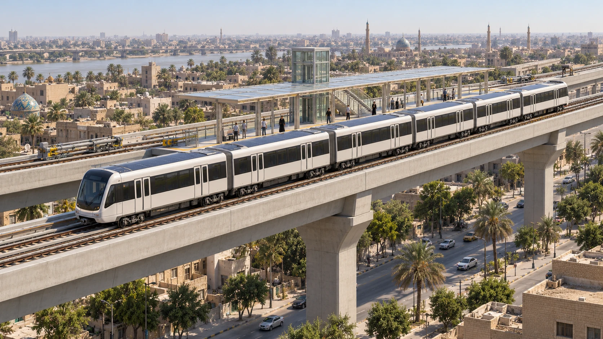
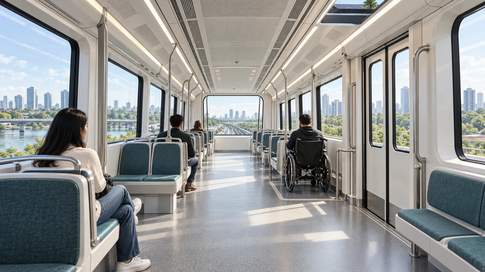
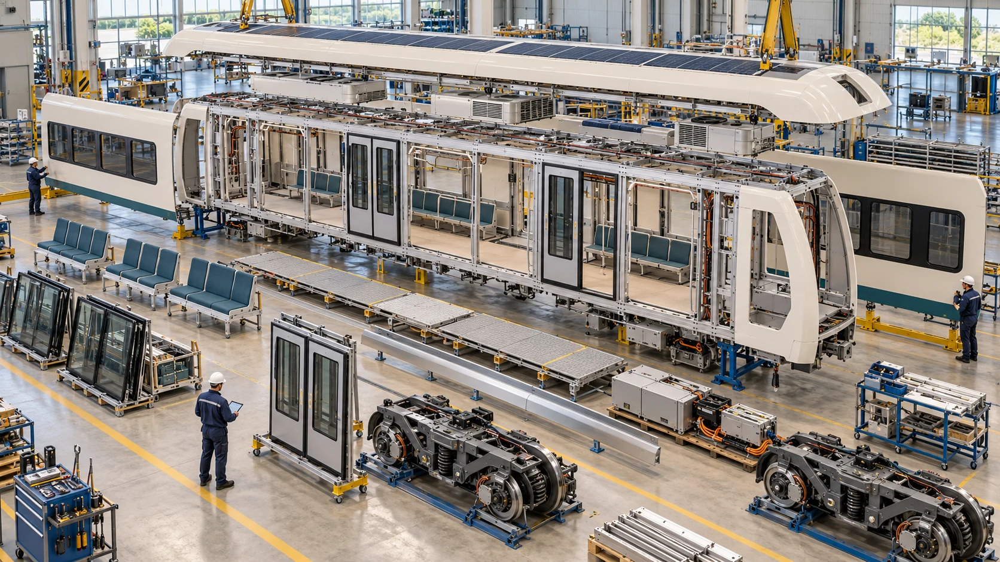
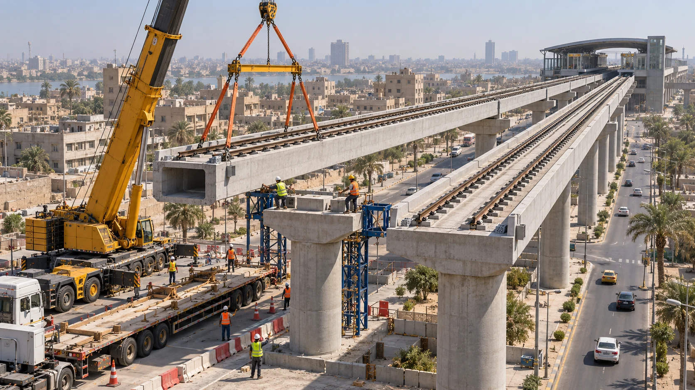
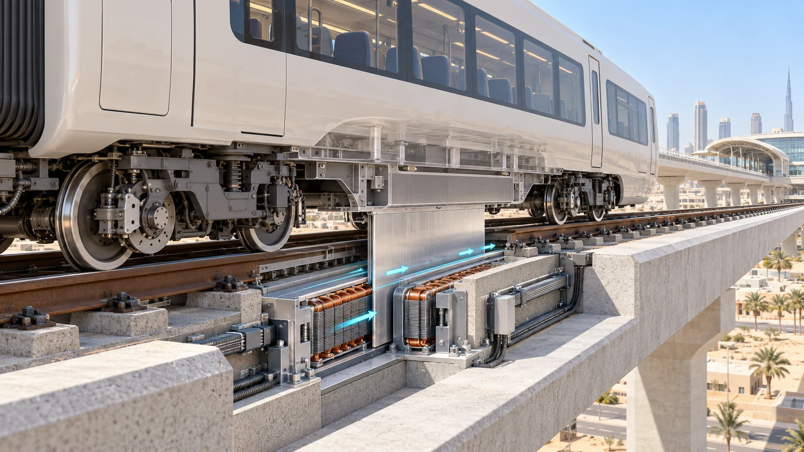

# OpenSourceRail: open railway design and delivery

OpenSourceRail connects city planning, railway engineering, manufacturing,
construction, business workflows and open train-control software. Its purpose is
to build local design authority, production and repair capability while
comparing whole-life cost and passenger service. These are project objectives;
economic superiority and physical qualification have not been demonstrated.

## Selected v0.6 research candidate

The selected reference is a station-powered, wheel-supported railway with
6 cars of 17 m. Each car is planned for
44 fixed seats and
2 wheelchair places, with no planned
standing. Passive steel-wheel bogies run on conventional rails carried by
concrete guideway. Double-sided station linear induction motors act on passive
onboard aluminium secondaries. The vehicle has no normal-service traction motor,
traction battery or suspension magnet. Independent braking, service power,
protection and rescue remain required.

The service targets are 72 km/h launch
speed, 120 seconds headway and 35 seconds
dwell. The resulting 8,280
passengers/hour/direction is capacity arithmetic, not a demonstrated protected
service. The selected candidate is a development reference without manufacturing
or passenger-operation release.



*Partial stock geometry and equipment accounts; not a complete installed or approved train.*

## Concept illustrations

These illustrations show the intended passenger experience, local assembly and
construction approach. They are concept artwork. Detailed dimensions,
accessibility, equipment placement and construction methods require controlled
engineering records; the images do not establish physical performance.

### Elevated train and station



A wheel-supported train on conventional rails beside an elevated station, with roof solar panels and a platform canopy.

### Accessible passenger interior



A bright seated cabin with a wheelchair space beside the doors. Detailed seat counts, boarding clearances and restraints require the controlled layout.

### Local vehicle assembly



Workshop assembly concept showing the body, roof, glazing, doors, seating and bogies as separate assemblies.

### Precast guideway construction



Illustrated precast-beam erection above an urban corridor. Lifting arrangements, temporary stability and site protection need their own engineered plans.

### Station LIM and passive secondary



Passive wheel bogies support the car while station-side double-sided LIM primaries act on a passive aluminium fin. Blue arrows illustrate the propulsion concept.

## Planning, engineering and delivery

The [planning workspace](workbench/planning/index.html) verifies current city
geography and route sources, then supports route, stop, service and OD proposals.
Run `./osr plan compile edits.json --output build/my-plan` to create an immutable
handoff bound to the selected candidate; run `./osr plan verify build/my-plan`
to verify its source files and identities. The handoff contains proposals only.
It excludes vehicle, propulsion, fleet, civil quantity, cost, performance and
cashflow results; those require candidate-specific evaluation. Planning
revisions do not grant movement authority.

From a verified handoff, create an immutable six-car factory work package
with:

```sh
./osr twin factory-draft compile build/planning-handoff --output build/factory-plan
./osr twin factory-draft verify build/planning-handoff build/factory-plan
```

The draft uses the selected candidate's Class C cost ledger and source-linked
low/base/high process hours under two 8-hour production shifts. It schedules one
serialized planning lane and does not infer crew size, parallel capacity or
calendar dates. Civil and railway-operations schedules, purchasing and
manufacturing release remain held.

The [coordinated design workflow](design-engine/coupled-railway/README.md)
propagates one candidate through geometry, mass, engineering analysis, BOM,
CAD/IFC, manufacturing, procurement, construction and controls. The
[current export manifest](design-engine/current/exports/manifest.json) and
[delivery package index](design-engine/coupled-railway/delivery-index.json)
bind research records to candidate identities. ERPNext exports are disabled
drafts. Complete installed equipment, an available operating motor map,
force-driven journeys and fully supported lifecycle costs remain open.

## Business and operating software

[ERPNext and Frappe HR](../deployment/erpnext/README.md) support draft business,
workforce, procurement, manufacturing, quality and maintenance workflows.
[FUXA and the gateway](../deployment/supervision/README.md) support equipment
observations, alarms, history and review-linked records. Site masters,
permissions, device bindings and reviewed imports require deployment-specific
configuration. These services do not commission a railway or supply movement
authority.

Cost scenarios use two 8-hour shifts for production and civil work. Operations
are modelled at two shifts for 16/18-hour service and three shifts for a 24-hour
case. These are planning assumptions, not approved staffing or operating plans.

## Start here

Run `./install.sh`, then `./osr status` and `./osr workbench`. Use
`./osr design railway plan` for coordinated research, `./osr build` to refresh
current evidence and `./osr verify` to check sources and payloads. `./osr sim
baghdad` reports the current city-evaluation hold.

[Project introduction](../README.md) · [Current engineering](design-engine/current/README.md) ·
[Architecture](ARCHITECTURE.md) · [Roadmap](ROADMAP.md) ·
[Candidate delivery](design-engine/coupled-railway/delivery-index.json) ·
[Reader](../OpenSourceRail-Book.pdf) · [Contribute](../CONTRIBUTING.md).

Software: Apache 2.0. Open physical designs: CERN-OHL-S v2. Documentation: CC-BY-SA 4.0.
See [licensing](../LICENSE.md) for the applicable path and upstream terms.

<!-- Generated by tools/automation/generate-public-overview.py; do not hand-edit. -->
