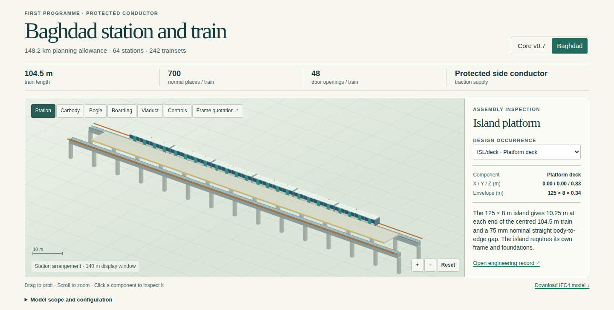
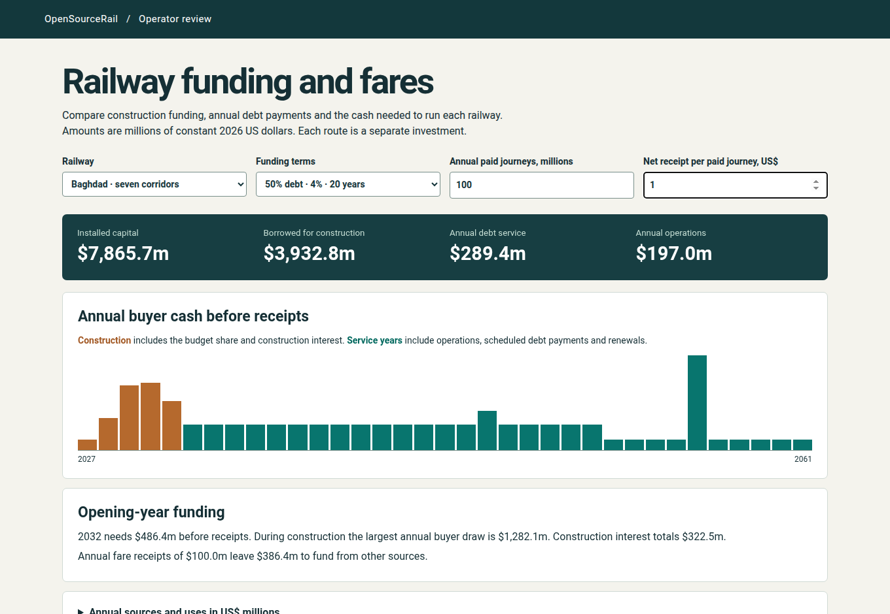

# OpenSourceRail for railway operators

[Download the illustrated operator briefing (PDF)](OpenSourceRail-Operator-Brief.pdf) · [Download the offline workshop kit](https://raw.githubusercontent.com/modernecotech/OpenSourceRail/main/docs/operator-review/OpenSourceRail-Operator-Kit.zip) · [Open the delivery workplan](WORKPLAN.md) · [Read the Baghdad proposal](../../cities/Baghdad/PROPOSAL.md)

Use this pack to review the railway with an operations director, chief engineer, financing team and local builders. The core example is a 30 km elevated railway with a six-car, 276-place train and overhead power. Baghdad’s seven corridors and independent citywide option use 700-place trains and protected conductor rail. Each has its own construction, service and funding assumptions. The digital designs support layout review, costing and prototype quotations. Site surveys, supplier terms, physical tests and operating authorisations remain open.

## Run a 30-minute operator review

For a presentation, open the PDF. In the running Workbench, the **Operator review** navigation opens the models, funding, staffing and control-room views. For an interactive meeting without an installation, extract the workshop ZIP and open **START.html**. The kit includes both models, the Baghdad proposal, maps, factory plans and the calculators. In a repository checkout you can also open the local HTML files below. The twin, funding calculator and equipment replay run offline. GitHub's file view displays their source. The PDF and PNGs can be viewed directly on GitHub.

| Time | Open | Operator task |
|---|---|---|
| 0–5 min | [Baghdad map and locations](../../cities/Baghdad/maps/README.md) | Trace the Red corridor through Adhamiya, then identify the missing names. Compare the airport entrance and interchange assumptions against local knowledge. |
| 5–12 min | [Train and station twin](twins/index.html) · [core IFC](twins/core.ifc) · [Baghdad IFC](twins/baghdad.ifc) | Switch between the two designs. Orbit the bogie, select a door, then inspect the platform, viaduct and control equipment. Read the engineering source for each part. Use IFC4 in your own model viewer. |
| 12–16 min | [Control-room replay](screens/supervision.html) · [operating screens](screens/README.md) | Compare a stale section indication with the last observed state. Identify who can authorise isolation or movement, and trace a workshop repair to a serial record. |
| 16–21 min | [Funding and fares](finance/index.html) · [buyer comparison](../../cities/Baghdad/BUYER-COMPARISON.md) | For the seven corridors, compare 50% borrowing over 20 years at 4% real with 12 years at 7%. Enter paid journeys and net fare receipts. Ask vendors for matched cash prices, debt terms and Iraqi value added. |
| 21–26 min | [Factory layouts and training plan](delivery/README.md) · [Staffing calculator](delivery/index.html) | Follow a car from frame jig to dispatch and a beam from casting bed to site. Identify who signs the hold points. Compare shift coverage, trained staff and yard space with the proposed production rate. |
| 26–30 min | [Workplan and opening decisions](WORKPLAN.md) | Agree an area to survey, a prototype interface to witness, a local package to quote and an owner for each decision. |



## Design records for a technical meeting

| Railway package | Core design | Baghdad design |
|---|---|---|
| Body, bogie, braking and replacement | [Powered train](../reference-v07/digital/vehicle/README.md) · [powered brake fixture and separate passive bogie study](../../engineering/interface_studies/REFERENCE-RIGS.md) | [Frame drawing, stock list and removal trials](../../cities/Baghdad/engineering/mechanical/vehicle/README.md) |
| Station, platform, span and foundations | [Joined geometry and interfaces](../reference-v07/integration/README.md) · [selected 13-strand beam](../reference-v07/digital/civil/README.md) | [Station sections, moving-load check and footing trial](../../cities/Baghdad/engineering/mechanical/civil/README.md) |
| Power, electronics and software | [Equipment schedule and software functions](../../control-electronics/README.md) · [vehicle and station software](../../crates/README.md) | [Door, brake and section sequence, wiring, fault tests and repair](../../cities/Baghdad/engineering/controls/README.md) |
| Production, staff and repair | [Parts and manufacturing routes](../reference-v07/manufacturing/README.md) · [production handoff](../reference-v07/digital/production/README.md) | [Delivery and local production quantities](../../cities/Baghdad/COST-AND-DELIVERY.md) · [factory and shift plans](delivery/README.md) |

## What the funding screen shows

The core comparison spreads capital evenly across the 43 construction months as a provisional draw schedule. Full annual operations start in relative Year 5. Renewals are $160m in operating year 15 and $70m in year 25. Baghdad uses the annual project schedules for construction, operating costs and renewal events. Interest on construction draws is paid from the buyer's budget. Changes to a fare scenario affect receipts only. Figures use constant 2026 US dollars. Quotes, exchange rates, fees and public-service agreements will affect a real contract. The illustration below uses 100 million paid journeys at $1 net each as a sensitivity. Neither input is a forecast. [Core cost and renewal basis](../reference-v07/cost/README.md) · [Baghdad debt schedules](../../cities/Baghdad/financing-scenarios.json)



## Reproduce the presentation

From the repository root, the following commands compare the finance and staffing inputs with the published results. The screen gallery and twin guides include their own reproduction instructions. The PDF renderer uses ReportLab, CairoSVG, Pillow and the DejaVu fonts.

```sh
python3 docs/operator-review/finance/build.py --check
python3 docs/operator-review/delivery/calculate.py --check
node docs/operator-review/finance/capture.mjs
python3 docs/operator-review/render_brief.py
python3 docs/operator-review/pack.py
python3 docs/operator-review/pack.py --check
```
