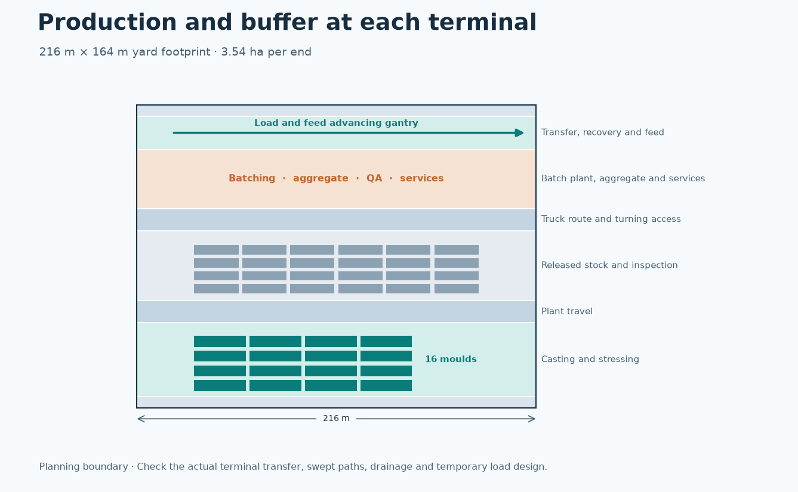
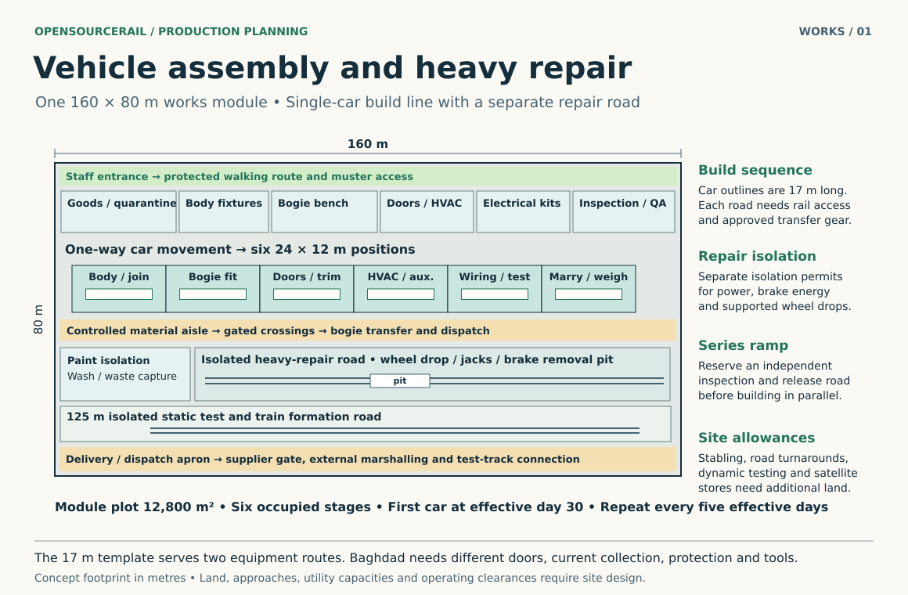

# Building and staffing the Baghdad railway

The current work orders use the mapped metropolitan route, the six-minute costing offer and recurring **20 m U-girders on shared piers**. The standard-stock plan covers **6.26 million paid hours** for casting, haul and erection. Use the candidate’s machine record for route-specific cash allowances, mould occupation, civil quantities and crews by role and shift. [Delivery and costs](../../../cities/Baghdad/STRAIGHT-THROUGH-DELIVERY.md) · [Live stock and pricing basis](../../../cities/Baghdad/engineering/mechanical/civil/LIVE-STOCK.md)

## Precast yard, stock and erection



Each terminal yard needs **16 moulds**, **24 released-stock positions** and **216 × 164 m** before external approaches. The standard-stock network programme allows **three paired launcher crews, two road teams and eight concurrent yards**. Release inspection, curing, staging, loaded flatbeds, gantry advance, track extension and verified support release must fit the same schedule. Book ground works and special lifts separately. [Curved and straight stock work orders](../../../cities/Baghdad/engineering/mechanical/civil/CURVED-BEAM-PROGRAMME.md)

## Vehicle works and repair access



Lay out fabrication, painting, fitout, wiring, weighing and final inspection, with a way to move a defective vehicle to the repair road. The cost envelope includes **581 trainsets with reserves**, or **3,486 cars**. Set delivery and ramp-up windows from the route opening sequence and price independent tooling, peak shared work, rework and supervision. Time one repeat car and a bogie exchange to check hours, staffing and lift access. [Vehicle workcells and technology survey](../../../cities/Baghdad/engineering/prototype/rapid-production/README.md)

## Employment, training and release

Use recorded service hours, locations, staffing posts, competency limits, relief and absence in a roster. Establish qualifications for deck access, stressing, lifting and temporary works, vehicle testing, platform dispatch and power isolation. Forecast classroom, simulator and supervised hours from the actual staff intake. Reassess authorisation after a change to equipment or duty, and include access for repair, rescue and passenger assistance.

| Work | Evidence needed |
|---|---|
| Casting and delivery | Mould and release cycles, shifts, concrete strength, load limits, yard moves, rejection rates and stop/start access |
| Factory | Actual cycle, setup, trades, supervision, tool availability, inspection and repair routing |
| Operation | Trained posts by location and shift, relief, dispatch, incident response and demonstrated maintenance tasks |
| Cost | Loaded local wage and contract rates, renewal and training scope, hours already priced in equipment or operation |

[Workforce simulator inputs and formats](WORKFORCE-SIMULATION.md) · [Rust and Arrow scheduling](WORKFORCE-RUST.md) · [Operator workplan](../WORKPLAN.md)

## Reproduce the quantities

```sh
./osr design railway baghdad-delivery --json
./osr workplan --output build/workforce
./osr coherence
```
