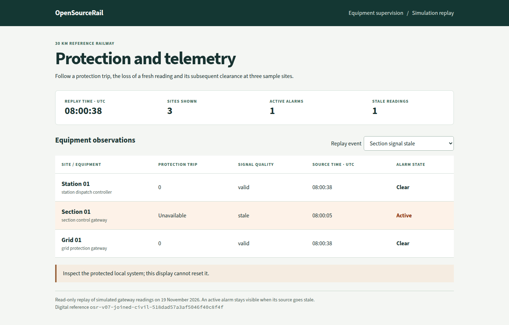
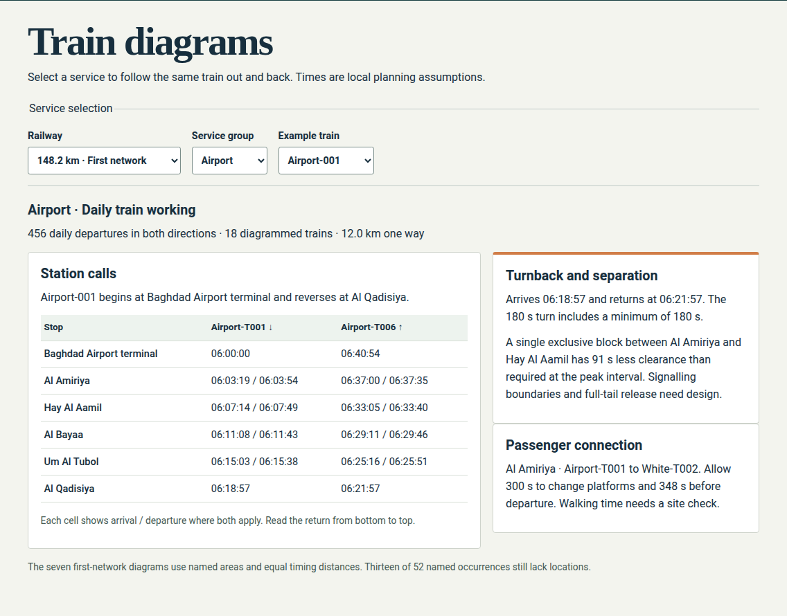
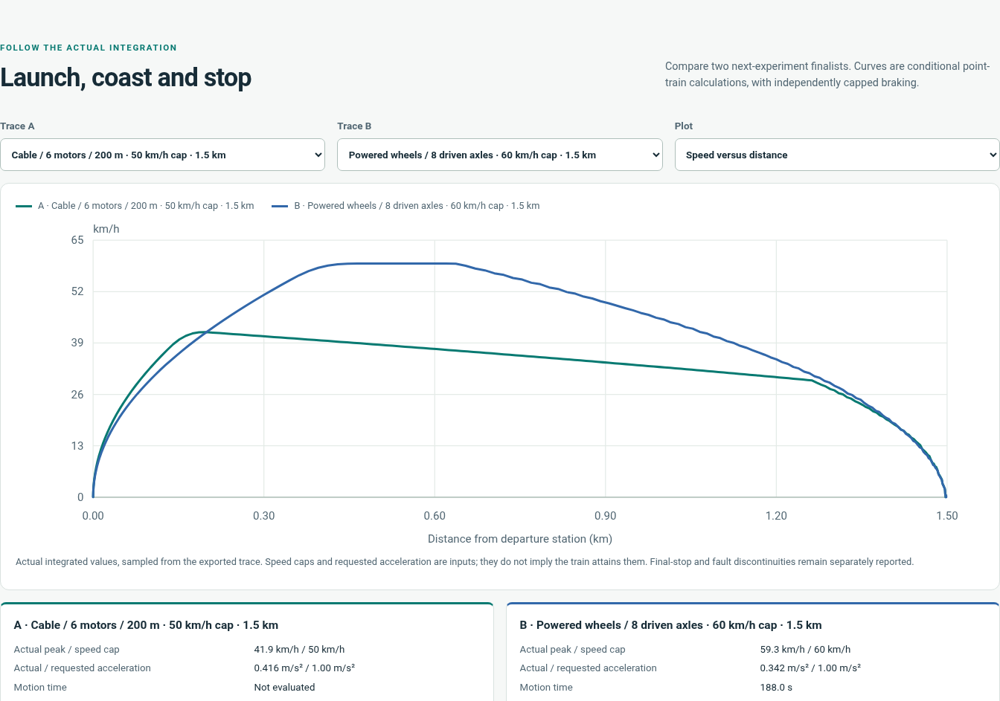
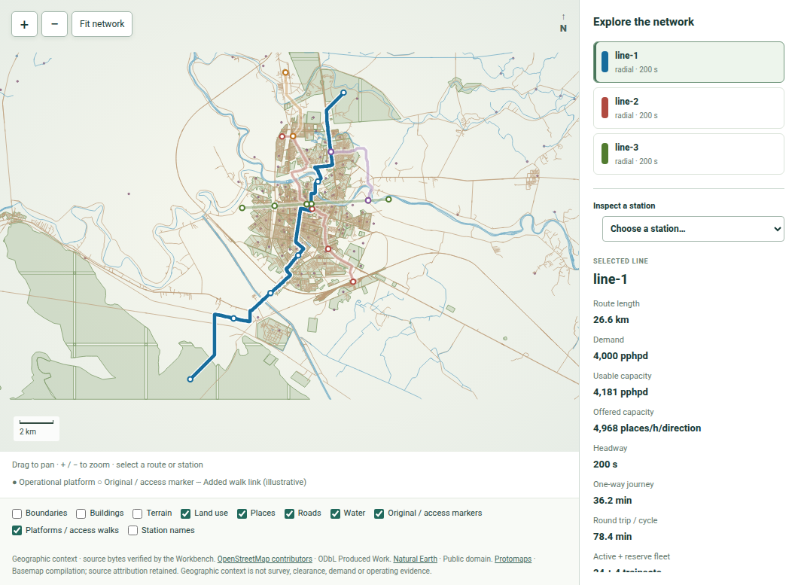
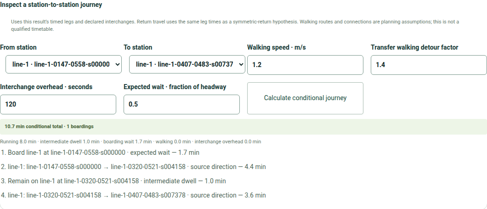
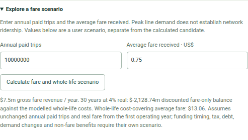
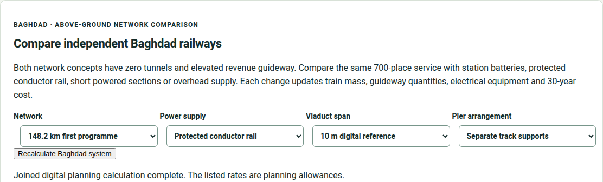
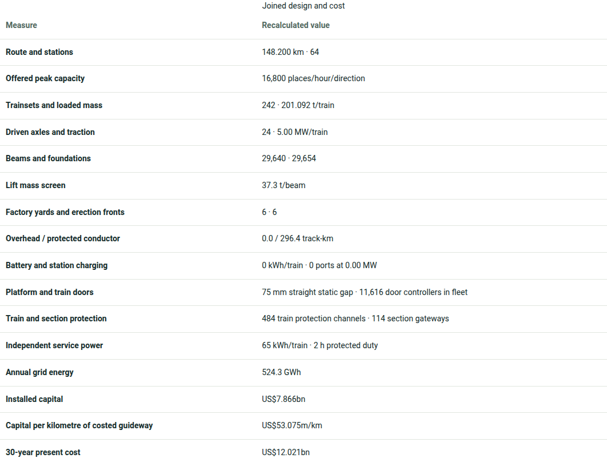
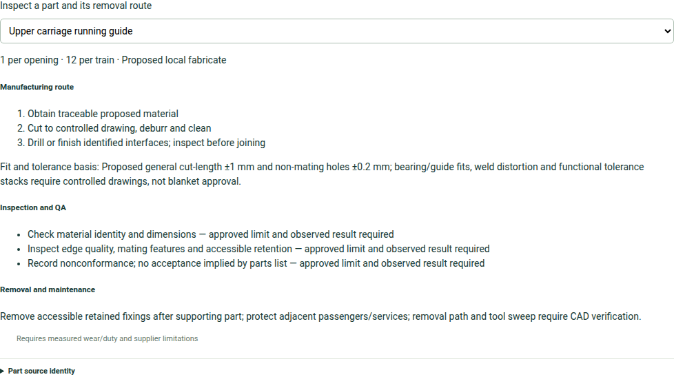
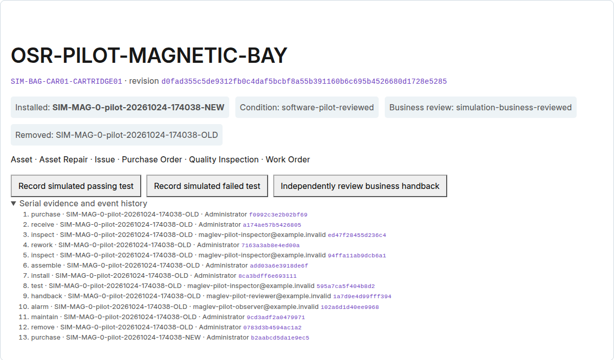

# Railway operations and planning screens

Start with the section alarm. Step from **Section trips** to **Section signal stale**, then to **Signal restored and trip cleared**. At 08:00:38 the section reading is 33 seconds old. The display marks the value unavailable and keeps the trip active. At 08:00:40 a fresh simulated clear reading changes the alarm state. The replay uses the gateway's alarm and data-quality logic for three sample assets from the 30 km digital reference. Its read-only display runs locally. [Open the replay](supervision.html) · [Selected equipment definitions](../../../services/integration/osr_integration/v07_supervision.py)



The repository also retains a native FUXA screen from the earlier business pilot. The v0.7 configuration generates 40 observation views for 12 stations, six grid sites and 22 sections. Device commissioning, connection to field equipment and movement authority remain open. [Earlier native FUXA display](../../../engineering/assurance/v053-candidate-lifecycle-native/fuxa.png) · [Equipment supervision deployment](../../../deployment/supervision/README.md)

## Trains and passenger journeys

**Baghdad daily service.** Follow Airport-001 from the terminal to Al Qadisiya and back. The card shows the local times, the three-minute minimum turn and the interval shortfall under a one-block-per-interstop assumption. Select M04 in the citywide view to see why the service remains held. [Open the timetable card](../../../cities/Baghdad/service-diagrams.html)



**Train movement.** Compare simulated speed against distance between stations for a cable launch and a powered-wheel alternative on the same 1.5 km leg. The curves use assumed force inputs. The interactive study also lets the reviewer compare stopping and fault cases. It belongs to the station-pair research programme. [Open the movement study](../../design-engine/station-pair/index.html)



**Route and service.** In Samawah's planning atlas, selecting a line shows its mapped extent alongside demand, headway, journey time and fleet. This example uses the original Samawah alignment. The Baghdad route and geographic uncertainties have their own city record. [Open the city Workbench](../../workbench/current/?outlineCity=samawah) · [Baghdad proposal](../../../cities/Baghdad/PROPOSAL.md)



**Passenger journey.** Selecting two stops on Samawah Line 1 gives a conditional 10.7-minute journey. The Workbench includes the expected wait, running time and intermediate dwell. Walking speed, detour, interchange overhead and wait fraction are editable assumptions. Times are planning results.



## Fares and city investment

**Fare sensitivity.** Ten million paid trips a year at US$0.75 yield US$7.5 million in annual gross fare revenue. This user-entered Samawah example compares the fare stream with projected whole-life costs over 30 years at a 4% real discount rate. Paid trips require a demand study. Baghdad has its own financing cases. [Baghdad financing scenarios](../../../cities/Baghdad/financing-scenarios.json)



**Baghdad design and cost.** The two screens show the same Workbench run. Selecting the 148.2 km schematic first programme, protected conductor rail, separate supports and 10 m spans gives 64 stations and a planning allowance of US$7.866 billion installed capital. The quantity table also shows conductor length, erection fronts, annual energy and 30-year present cost. Alignment, ground conditions and supplier prices require validation. [Baghdad options and cost basis](../../../cities/Baghdad/COST-AND-DELIVERY.md)





## Workshops and maintenance

**Door guide.** The Samawah Workbench's research door module shows 12 upper carriage running guides per train. A workshop can inspect the proposed production sequence, quality checks and removal path. The limits and clearances need controlled drawings and inspection evidence. [Door module source](../../../engineering/vehicle_parts/door_module.py)



**Serial maintenance history.** A native ERPNext fixture links a magnetic-bay position to its installed and removed serials, inspections, repair and work orders. The expanded history records a simulated replacement and business review. This is the earlier magnetic-pilot business workflow. The capture read the existing inspector view without submitting a transaction. HRMS is installed on that fixture. Access to training programmes and events requires a workforce role. The operator package includes proposed workforce and training arrangements. [Factory and workforce plan](../delivery/README.md)



## Reproduce the captures

From the repository root, regenerate the deterministic alarm scenario and start the loopback Workbench.

```bash
.venv/bin/python docs/operator-review/screens/replay.py
.venv/bin/python -m engineering.development_baseline.server --root . --host 127.0.0.1 --port 8090 --no-browser
```

In a second terminal, use the installed repository Playwright dependency and a local Chromium executable.

```bash
OSR_BROWSER_EXECUTABLE=/usr/bin/google-chrome \
  node docs/operator-review/screens/capture.mjs build/operator-screen-review
```

To include the ERP screen on an existing demonstration site, set `OSR_ERP_FIXTURE` to its private inspector login fixture. The script authenticates to the historical loopback site at port 18088. Without that variable it captures nine public demonstration views. To update only the Baghdad timetable image and its receipt in the existing gallery, run `node docs/operator-review/screens/capture.mjs docs/operator-review/screens --timetable-only` against the loopback Workbench. `OSR_WORKBENCH` accepts another loopback origin. The receipt records the captured image and source hashes, specific door and Baghdad identities, and browser version. The committed captures use Chromium 156.0.8078.47. [Capture receipt](captures.json) · [Capture script](capture.mjs) · [Gateway replay input and checks](replay.py)
