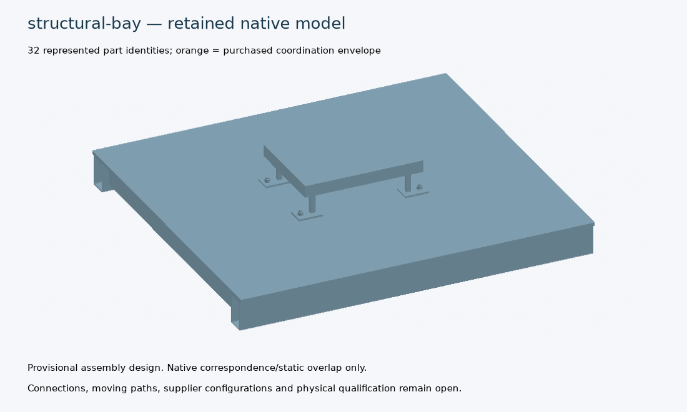

# Design-closure review follow-up — 20 October 2026

The review through `f6d7a790` has been followed by a new qualified source epoch,
an executed design campaign and a verified portable publication. These remain
provisional research designs. **No engineering task, digital specification,
physical validation or manufacturing release is claimed complete.**

[Publication](../../../docs/design-engine/assembly-design/index.html) ·
[Executed qualification](../../../docs/design-engine/assembly-design/qualification.json) ·
[338-test log](../../../docs/design-engine/assembly-design/tests.log) ·
[Exact results and limitations](summary.json) ·
[All 88 closure tasks](../../../docs/design-engine/assembly-design/closure-progress.json)

| Review priority | Delivered change | Remaining boundary |
|---|---|---|
| Numerical portability | The existing reproduction utility permits round-off only in named catchment sampling diagnostics. Retained self-hashes, source/geometry bytes, populations, counts and decisions stay exact. | Replay tolerances do not relax engineering acceptance. |
| Evidence-driven completion | Source-bound task/component/interface contracts consume original signed author/reviewer records and artifact bytes. Stale history is retained; new valid revisions can replace stale coverage. Current failures remain vetoes. Original evidence travels with the export. | Trust pins and the real submission index are empty. The tests use synthetic keys and fixtures; they are not accepted project records. |
| Installed equipment | One provisional instance layout defines 48 complete LV/ventilation cassettes and 18 refrigeration boundaries. Mass/inertia, cut conductors, known model power/conditioning demand, electrical group IDs and thermal quantities use the same definition. Rebuilt checksums cannot conceal inconsistent duty inputs or counts. | Refrigeration mass, trunk routing, host packaging, maintenance access, actual ratings and costs remain unknown. Gross additions earn no removal credit or adopted train-mass change. |
| Structural alternatives | The domain now has 54 frame/floor/support alternatives. A 12 mm floor with four crossmembers has 200.708 kg represented mass, versus 230.395 kg for the retained 16 mm/two-crossmember comparison. Both feet per loaded strip and both added support beams are checked. The 8 mm alternative remains rejected. | These are isolated bay screens; weld/coating/services, full carbody behaviour and qualified connections remain open. |
| Reinforcement choices | Six round bent-link/hook/coupler schedules include bend radii, hook arcs/tails, congestion, assembly and inspection requirements. | Curved native geometry, actual closures, development, confinement and resistance are incomplete. These alternatives are excluded from cap selection. |
| Panel workflow | The registered runner companion evaluates 172 aluminium/GFRP hypotheses, including continuous rear insulation and a coupled higher-temperature core alternative. Six owned-section native CAD/IFC/image exhibits and independent metal bending controls were executed. | These are unadopted panel research footprints. Complete core/potting, fastenings, formed roofs, joints, whole-stack temperature/fire and manufacturing acceptance remain open. |

**Executed:** 92 queued experiments, with no execution errors: 69 research
rejections, 21 held cases and two offline software trials. Research-screen
failures remain recorded separately from execution failures. The companion
retains 93 detailed variations: 12 cassette, 27 civil and 54 structural recipes.
The structural recipes repeat the queue domain and are not additional unique
designs. All three detailed exhibits passed native correspondence: cassette
184 parts, civil cap detail 47 parts and structural bay 32 parts. All six panel
section exhibits also passed their scoped native checks.

**Validation:** 338 qualification tests passed, with no required native tests
skipped. Another 31 panel/numerical and 20 city federation/status tests passed.
The rebuilt proposal and archive checks added 22 passing tests: **411 scoped
tests passed** across these groups.
The approximately 36.1 MiB portable assembly export is below its 48 MiB cap;
its source, receipts, raw archives, original-byte checks and report consistency
were verified. See the publication manifest for exact bytes.

[Native panel pictures and CAD](../../../docs/design-engine/assembly-design/studies/panels/index.html) ·
[Detailed cassette, civil, system and manufacturing studies](../../../docs/design-engine/assembly-design/studies/index.html) ·
[Cassette fixture insertion/removal video](../../../docs/design-engine/assembly-design/studies/service-cassette-detail/fixture-motion.mp4) ·
[Synthetic system-duty trace video](../../../docs/design-engine/assembly-design/studies/coupled-duty.mp4)

The next engineering exits still require an adopted six-car layout/load/duty
baseline; complete carbody and foundation-to-track designs; current supplier
configurations; site investigations; calibrated physical correlation and
independent acceptance. Passing native or publication checks cannot close those
gates.
