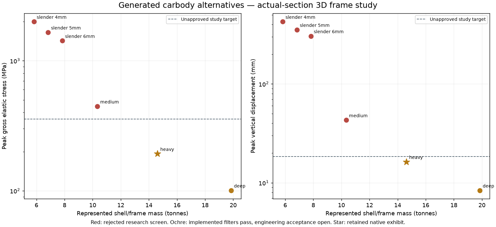
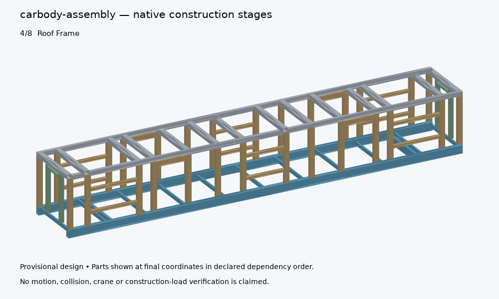
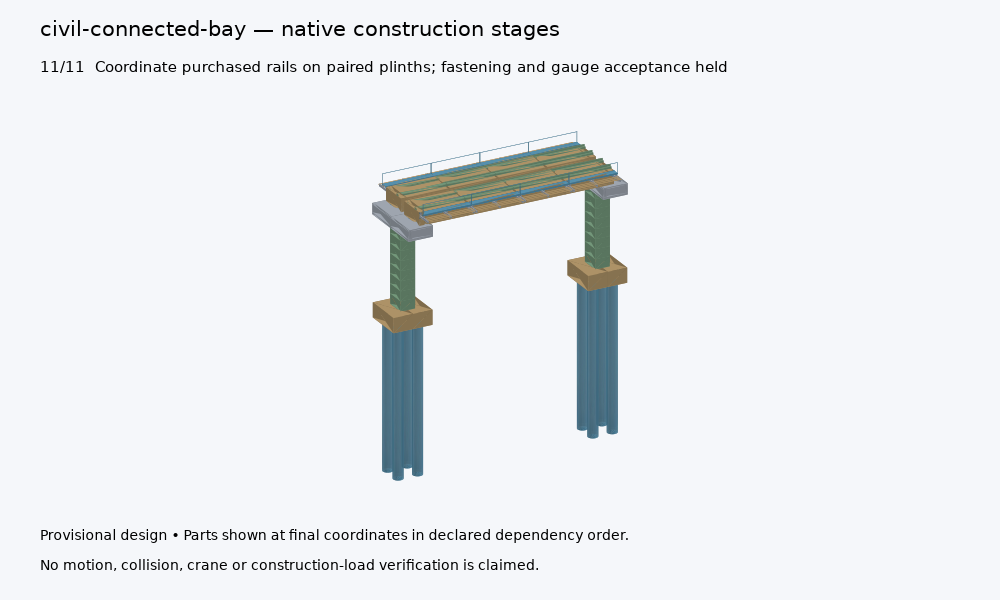

# Baghdad connected design delivery — 20 October 2026

This delivery extends the existing qualified assembly workflow with whole
repeated-carbody geometry and a connected representative civil bay. It remains
a provisional design package. The 88-task closure ledger retains independent,
physical and project-acceptance gates; code, CAD and publication checks do not
close those gates.

## Mechanical design and improvement

Six equal-envelope carbody alternatives retain actual door/window voids,
underframe members, side/end/roof frames, floor sheets, cladding, glazing and
door-leaf boundaries. Primary stock members are divided into transportable
lengths with explicit unqualified splice details. The 18.5 m length comes from
the controlled six-car configuration; the transverse envelope and 1.0 m floor
datum remain unadopted packaging hypotheses.

The initial slender frames fail the connected 3D elastic analysis. Stronger
portal/sill/header alternatives preserve the clear openings. The selected heavy
research alternative represents about 14.6 tonnes of shell/frame material. Its
maximum tested vertical displacement is about 16.3 mm and its maximum gross
elastic fibre stress is about 193 MPa. The retained seven load cases include
planning, refinement, doubled vertical load, lateral/braking/eccentric
sensitivities and represented self-weight.

The Timoshenko network uses actual RHS sections and named physical joints,
with centroid eccentricities represented by explicit ideal rigid offsets. No
stiffness is invented for cladding, glazing or floor sheets. Independent
closed-form element controls, equilibrium, refinement and adverse scaling are
executed. Nominal S355 stress and length/1000 displacement screens are
provisional comparisons, not adopted railway acceptance criteria. Qualified
joints, local buckling, actual bogies, crash/fatigue and physical correlation
remain open. The original sill-only diagnostic is preserved.

## Connected civil bay

The 328-part representative cell preserves the source concrete and explicit
unmodeled mass allowances. Individually manufactured paired plinth strips
preserve concrete volume while providing the stated 1435 mm inner-head rail
gauge. Added walkway/service support frames, bearers, seats and accessible
connection boundaries have physical geometry and an explicit assembly order.

Nine alternatives compare three deck architectures and three bracket stock
gauges. Independent elastic support checks and the shared signed gravity
distributor account for added material and walkway/service load hypotheses.
Some larger span lifts fail the common provisional crane-at-radius scenario;
these rejections remain available. Actual ground, reinforcement/prestress,
embedded anchors, bearing configurations, rail fastening, construction-stage
resistance and physical acceptance remain open.

## Published files and presentation

- [English/Arabic offline assembly explorer](../../../docs/design-engine/assembly-design/studies/systems/index.html)
- [Carbody frame and geometry files](../../../docs/design-engine/assembly-design/studies/systems/carbody-assembly/)
- [Civil geometry and assembly files](../../../docs/design-engine/assembly-design/studies/systems/civil-connected-bay/)
- [Exact installed-geometry check](../../../docs/design-engine/assembly-design/studies/systems/installed-geometry/result.json)
- [All qualification tests and portable evidence](../../../docs/design-engine/assembly-design/index.html)
- [English browser capture](explorer-en.png) and [Arabic browser capture](explorer-ar.png)

The explorer provides part/material/process search, physical joint references,
retained native images, editable FreeCAD, STEP, IFC, unissued inspection layouts,
QA plans, comparison schedules and raw numerical results. Stage videos use
native triangles at final coordinates, appearing in declared dependency order;
they do not simulate insertion, crane motion, contact or construction strength.
The separate cassette fixture animation retains its rigid-motion scope.

The cassette/carbody check binds all 48 controlled instance IDs, exact CAD bytes
and installed owned-part IDs. Zero solid interference at these coordinates
does not establish frame alignment, passenger headroom, service access or an
approved installation. Two refrigeration datums remain unresolved against the
proposed door circulation areas. No combined system admission is claimed.

The older federated design packet was regenerated and independently replayed
after stale source references prevented its runner from starting. Original
historical results remain retained. Current proof hashes and executed test
counts are recorded in the accompanying summary and logs.
