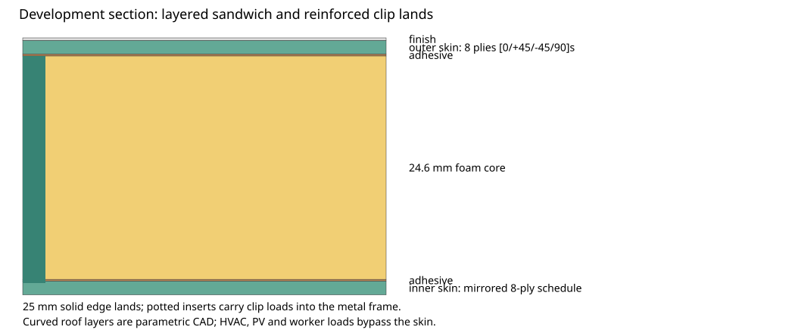

# Hybrid GFRP exterior-panel development

2592 conditional panel/support combinations; no candidate is released or changes the train mass/BOM.

[Interactive comparison](report.html) · [Complete-scope RFQ prepared for review](rfq.json).

The metal frame remains the main structural load path. HVAC, PV, lifting and personnel loads pass into its dedicated supports. The reference section has two 1.5 mm eight-ply skins, two 0.2 mm bonds, 24.6 mm core and a separate 0.3 mm finish. Material values, pressure, ageing factors and roof crown are explicit development assumptions.

[Complete comparison](comparison.csv) varies skin, core depth/density, module width, clip/support span, roof crown and hat-rib depth. Rib mass is counted; rib stiffness and bond benefits await evidence. Mass includes solid edge lands, potting, inserts, clips, retention, seals and finish. Curvature earns no stiffness credit. Classical laminate ABD and one-way pressure-strip bending plus core shear are numerical screens, not plate/clip fatigue or debonding qualification. Density selects a coupled supplier-grade property record at 23 C. Every support pitch generates steel rails, brackets and fasteners with installed mass; grade-specific hot/wet, fire and attachment qualification remains open. An 85 C roof exceeds the selected grades at their 70 C continuous-temperature datum and cannot pass thermal selection.

[Reference panels](reference-panels.json) · [Actual aperture-based 144-module inventory](trainset-takeoff.json) · [Steel/aluminium comparisons](metal-comparators.json) · [All candidates](candidates.json) · [Shared support geometry](support-networks.json). Shared-joint seal quantities remain a gross allowance; the cutout clip map and final roof crown remain unreleased. Bare 2 mm metal sheets are unequal-performance comparators. Separate metal plate assemblies are thickness-sized to the same pressure/support/deflection surrogate and include common attachment, finish and insulation allowances. This is not an optimum metal stiffener design or demonstrated equivalent rail behaviour. No whole-train saving is claimed.

[Prototype/quotation status](prototype-and-quotation-status.json) derives from the editable [evidence register](../evidence/register.json). Record candidate ID, dry/hot-wet condition, metre-valued measured deflection, uncertainty and original-file SHA-256 for correlation. Tests must reproduce the candidate pressure/support/material configuration. Quotations require the complete named scope. Empty records stay unknown; the $11,000 B6/B7 allowance is a comparator, not a quote.

Coupon tests precede a clipped side module and an equipment-adjacent roof bay. The register covers aged stiffness/bond/pull-out, pressure, clip loss, vibration/fatigue, impact, heat beneath PV, ingress, UV/sand/wash, bonding and measured replacement. Fire requirement set/hazard level and the exact complete stack remain unfrozen.

Regenerate: `.venv/bin/python tools/automation/composite-panel-study.py`; use `--check` for source/output drift. [Native layered side and curved roof CAD](cad/verification.json) validates nonoverlapping solids and independent volumes; curved roof insert lands remain separate development. Native CAD export/volume verification uses `tools/automation/verify-composite-panel-cad.py` in FreeCAD. Native exports do not establish physical performance.

Supplier and standards references: [DIAB coupled core grades, May 2026](https://diab-media.azureedge.net/eyajkrhd/diab-divinycell-h-may-2026-rev26-si.pdf), [BSI EN 45545-2:2020+A1:2023](https://knowledge.bsigroup.com/products/railway-applications-fire-protection-on-railway-vehicles-requirements-for-fire-behaviour-of-materials-and-components-2), [Sicomin SR1124](https://sicomin.com/en/epoxy-products/epoxy/contact-vacuum-lamination/sr-1124/), [its datasheet](https://sicomin.com/datasheets/sr1124_sr477x.pdf), [AIREX T90](https://www.3accorematerials.com/en/markets-and-products/airex-foam/airex-t90-fire-resistant-foam), [Mat4Rail results](https://cordis.europa.eu/project/id/777595/reporting). Supplier resin Tg and core thermal stability are separate from allowable panel service temperature.
