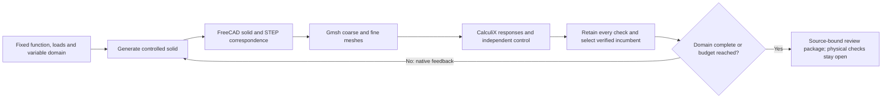

# Shared Design Engine

The common engine connects existing physical definitions and solvers through
one scoped problem, candidate, job, verification matrix and review package.
Legacy studies retain their formats and record ownership. Computation is local;
GitHub Actions remains disabled.

The [factory integration](../../docs/design-engine/factory-integration-2026-10-16.md)
adds controlled fixture and precast problems, coupled handling/restraint/resource
comparisons, partial per-instance inventories and native CAD confirmation through
the same jobs and exports. `factory-native` requires fresh FreeCAD execution of
nine retained models and both adapters; structural and production gates stay open.
The [support and scheduling extension](../../docs/design-engine/factory-support-notes-2026-10-16.md)
adds tension-only anchors, compression-only grout and a finite resource calendar.
Common native exports include a static review packet; the
[published snapshot](../../docs/design-engine/factory-support/index.html) is
verified against its retained files and can also be checked for current sources.

```bash
./osr design problems
./osr design run --problem clipped-side-bay --city samawah
./osr design refine --problem clipped-side-bay --city samawah --evaluations 256
./osr design jobs --city samawah
./osr design verify run-0123456789abcdef
./osr design verify run-0123456789abcdef --historical
./osr design compare run-0123456789abcdef run-fedcba9876543210
./osr design export run-0123456789abcdef --output build/review/my-fresh-package
```

Generate real parts and iterate with native feedback:



```bash
./osr design iterate --problem mechanical-cleat --city samawah --finite-exhaustive --proposals 12 --confirmations 6 --evaluations 64 --wall-seconds 1800
./osr design iterate --problem civil-steel-beam --city samawah --finite-exhaustive --proposals 12 --confirmations 6 --evaluations 64 --wall-seconds 1800
./osr design export <job-id> --output build/review/generated-part --native
```

The mechanical family varies plate thickness and a lightening hole in a drilled
steel cleat. The civil family varies wall thickness and RHS/I-section topology
on a fixed beam envelope. Each has six declared combinations, fixed material
assumptions, loads, supports and provisional displacement limits. These are
actual subtractive solids, not a complete bolted connection or railway structure.

The installed FreeCAD command-line tool produces a native document, BRep, STEP
and inspection SVG. Gmsh meshes that BRep with quadratic tetrahedra. CalculiX
solves two mesh sizes; separate checks compare CAD mass/CG/inertia with signed
primitive integrals, integrate end-face loading, balance support forces/moments,
compare displacement and mesh volume, and solve an independent simple-beam
control. Raw decks, meshes, reactions, stresses, logs and failures remain in the
attempt. Export retains these original files; it does not rerun the search.

The recursive controller uses native outcomes to choose subsequent neighbours.
It fixes variable ordering, tie breaking and real-variable quantisation, records
the complete request, source hashes and actual tool versions/binaries, and keeps
immutable progress frames before long evaluations. Identical completed inputs
and tools produce the same decision trace; this is not a claim that every CAD
archive or timing byte is reproducible. A source/tool change invalidates current
applicability. Resume appends a fresh attempt; it does not silently reuse partial
solver output or promise continuation from an interrupted native solve.

`--proposals` bounds policy proposals **and confirmations**; `--confirmations`
bounds native confirmations. `--rounds` bounds controller iterations. The common
`--evaluations` budget separately charges compilations and actual solver cases,
including benchmarks. Wall, memory and artifact limits also apply. Invalid
geometry, failed constraints, unavailable tools, cancellation and exhausted
budgets stay visible. Finite exhaustive mode visits every declared combination
within its budget. Otherwise the report states the tested coverage and stop
reason; a local stall is not evidence of a global optimum.

“Best verified in the tested domain” requires complete native numerical checks
and known requested objectives across the finite domain. The general global
optimum flag remains false. Unknown prices cannot become zero-cost winners.
Material strength, fatigue, nonlinear buckling/contact, actual joint behaviour,
site conditions, physical correlation and independent acceptance remain open;
numerical serviceability checks grant no production or physical release.

The same controlled feedback policy can call the existing panel, roof, viaduct
and foundation confirmation adapters. Other adapters report their unsupported
native-iteration preset instead of inventing a solver pass. The guided UI
provides recursive controls, lineage and native artifacts. See the
[review of twelve design systems and primary sources](../../docs/design-engine/generative-systems-review.md)
for the ideas used here and optional frameworks that are not integrated.

Every mandatory check participates in the recommendation veto. A `failed` or
`outside-domain` result excludes the candidate from both screening and verified
frontiers, including failures in material, thermal or physical qualification.
Unknown physical qualification permits only a conditional numerical comparison.
Civil iteration requires geometry, mass/inertia and service screening before
native refinement; unresolved interfaces and degraded-service qualification stay
visible. The current fixed deck fails its service limit and remains excluded.

Run required installed-tool acceptance with
`./osr validate run --profile native-design`. Missing prerequisites, skipped
mandatory tests or incomplete native artifacts fail this profile. See the
[local validation instructions](../../docs/local-validation.md) for receipt
verification and the separate software release requirements.

The [15 October native execution record](../../docs/design-engine/generated-parts-verification.json)
retains source/tool identities, all candidate check states and repeated decision
hashes. Four complete jobs made 72 actual CalculiX calls (candidate meshes and
independent controls). Each six-choice domain was tested twice with identical
decision traces; failing serviceability cases remain in the record.

| Bounded research selection | Starting mass | Selected mass | Native displacement | Retained design |
| --- | ---: | ---: | ---: | --- |
| 12 mm lightened drilled cleat | 0.936673 kg | 0.917733 kg | 0.92145 mm / provisional 1 mm limit | [STEP](../../docs/design-engine/generated-parts/mechanical-cleat/part.step), [FreeCAD](../../docs/design-engine/generated-parts/mechanical-cleat/part.FCStd), [inspection](../../docs/design-engine/generated-parts/mechanical-cleat/inspection.svg) |
| 8 mm I-section civil beam | 32.2164 kg | 30.5208 kg | 6.66285 mm / provisional 8 mm limit | [STEP](../../docs/design-engine/generated-parts/civil-steel-beam/part.step), [FreeCAD](../../docs/design-engine/generated-parts/civil-steel-beam/part.FCStd), [inspection](../../docs/design-engine/generated-parts/civil-steel-beam/inspection.svg) |

These files are unissued research outputs. Reproduce the actual four-job native
validation with `tools/automation/osr-python tools/automation/validate-generated-parts.py --output build/generative-design/a-fresh-native-replay`.
All raw attempts and two verified offline review exports remain local. This
record does not replace historical physical studies or the full software
release gate.

Candidate JSON is a list of complete variable maps supplied with `--candidates`.
Function, units, variable domains, load cases, model limits and mandatory checks
are declared before execution. Side and roof bays are separate problems; a
smaller roof cannot win a side-panel comparison. Missing complete installed
mass, prices, lifecycle scope, carbon and calibration stay unknown.

Jobs use an indexed local store at `var/design-engine`. Each attempt retains
its request, outputs, failures and manifest. Resume requires unchanged source
and solver environment and appends an attempt. Cancellation never erases the
original attempt. Native input, evaluation, time and memory budgets remain
separate from the engineering checks.

Screening and detailed confirmation have separate rankings and evidence.
The panel adapter calls the existing mapped plate/rail solver, mesh comparison,
all individual clip-loss cases and combined pressure/fault holdouts. It retains
adverse results. Curved geometry cannot use that flat plate model. Assembly
adapters preserve unresolved supplier inventories, site calibration, full
passage/contact domains and independent decisions.

Review exports preserve exact source and attempt bytes, quantities, mandatory
checks, RFQ scopes and licensing for offline review. They prepare drafts;
they cannot overwrite adopted finance, production or railway baselines.
Local hashes do not authenticate an executor, establish physical correlation
or appoint an independent assessor. See [licensing](LICENSE.md).

For the fixed-function side-panel pilot, pass `--candidates engineering/design_engine/data/panel-pilot.json --shortlist 4` to `refine`. Add `--native` to `export` for bounded shortlist CAD/STEP/unissued drawings and available IFC. The UI downloads hashed review chunks and original attempt logs, including failed runs.

Future record verification uses independently authenticated Ops Core accounts (existing `approver` or `admin` roles), rather than the appointed-role text. Cost scope completeness and finite-resource schedules are available in the common UI. See the [acceptance status](../../docs/design-engine/plan-status.md) for incomplete engineering packages.

Current physical candidates accept scoped manufacturing/site/prestress input drafts in the inspector. Original definitions remain immutable; failed geometry, clearance and conditional stress checks are retained. Public converter/PV candidates are previews with no installed credit. Searches retain charged finite sensitivity; vehicle confirmation conserves separate equipment/modal mass and checks actual whole-assembly coverage. Independent numerical benchmarks include `electrical-balance`, `prestress-reference` and `vehicle-conservation` through `tools/automation/design-benchmark.py`.

The CLI accepts `--project`, `--revision`, `--baseline-sha256`, `--run-id`,
`--asset-id` and `--part-id` to preserve a complete identity. A baseline omitted
from the request stays unknown and cannot support a reviewed-input revision.

The guided Workbench flow retains independently reviewed manufacturing, site,
prestress and foundation inputs, then creates a new immutable child job. Every
ancestor's proposal, review and document bytes are checked and included in
private offline exports. Independent review permits research use; it grants no
physical release or baseline adoption.

`civil-system-alternatives` and `vehicle-assembly` connect existing broader
families with fixed functional scope. Optional `--interactions <file.json>`
accepts `{"factors":{"support_span_m":[1.0,0.5],"core_m":[0.02,0.0246]},"evaluations":4}`
for a panel study. All corners use the actual compiler/screen and common budget;
missing economic/carbon inputs remain unknown.

Full-train confirmation divides the remaining declared job wall budget among
outstanding native cases and retains each allocation. The older hardcoded
45-second diagnostic budget is no longer imposed by a common worker. A longer
budget can execute a full passage, but time/deck/rail/modal convergence and the
contact domain must still pass separately.
