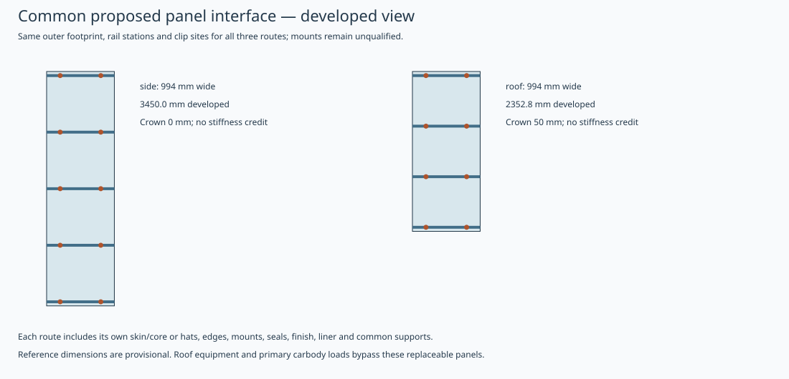

# Replaceable body-panel material benchmark

Aluminium is the reference hypothesis for straightforward removable panels. GFRP remains an alternative for curved ends, fairings and roofs. Primary carbody structure is a separate design decision.

172 generated side/roof hypotheses compare stiffened aluminium, aluminium sandwich and GFRP sandwich. **No engineering-eligible or released design is selected.** This standalone reproducible benchmark does not change the adopted train BOM, price, mass or the qualified background runner.

[All candidate definitions/results](candidates.json) · [Comparison CSV](comparison.csv) · [Common interface contexts](contexts.json) · [Summary](summary.json) · [Prepared RFQ](rfq.json) · [Sources and British manufacturing shortlist](../config/sources.json)

| Location | Route | Installed kg | Deflection mm | Conduction R m²K/W | Four provisional screens |
|---|---|---:|---:|---:|---|
| side | stiffened-aluminium | 63.07 | 2.84 | 1.047 | Conditional pass |
| side | aluminium-sandwich | 80.46 | 0.76 | 1.044 | Conditional pass |
| side | gfrp-sandwich | 46.20 | 3.34 | 0.631 | Conditional pass |
| roof | stiffened-aluminium | 49.48 | 2.67 | 0.922 | Conditional pass |
| roof | aluminium-sandwich | 62.03 | 0.68 | 0.918 | Conditional pass |
| roof | gfrp-sandwich | 55.48 | 1.30 | 1.219 | Conditional pass |

For each location/route, the table shows minimum installed mass meeting the four provisional screens; if none does, it shows the lowest-deflection diagnostic. Candidate IDs and exact selection reasons are in summary.json. A failed diagnostic is never promoted.

All routes use the same developed footprint, proposed rails/clip sites, actual rail span, 2 kPa editable pressure and 5 mm deflection screen. These are research assumptions, not approved railway loads or acceptance limits. Roof curvature earns no membrane stiffness. Solid bays are screened; door/window cutouts and compound-curved ends need their own matched generators. The historical 144-module three-car inventory is not a six-car quantity or a new mass estimate.

Installed inventory includes skins, core/insulation, solid edge closures or returns, hats where used, potting/inserts or backing plates, clips, independent retention, seals, finish, a common provisional liner allowance and the same actual steel rails/brackets/fasteners. The parent structural frame and equipment are excluded equally. Folded returns use ideal mitered strip lengths; bend allowances and mount geometry need manufacturing CAD. Complete rail fire performance of the liner and entire stack remains unknown.

The folded-sheet screen adds local skin bending between hats to global face/hat strip bending. Full face effectiveness, perfect hat attachment and simple supports are ideal assumptions; fastener slip, shear deformation, local buckling, joints, strength and fatigue remain open. Sandwich screens assume perfect bonds; laminate ABD is retained for GFRP. Sensitivity factors are deliberately material-specific and uncalibrated, not measured hot/wet or temperature allowables.

Conduction is screened separately from bending against an editable 0.6 m²K/W review threshold. The original continuous-metal details retain their failed thermal screens. New aluminium variants add a continuous rear insulation layer with explicit steel through-pin heat paths, mass and depth. These are proposed thermally broken constructions, not selected attachment systems. No cost or assembly-speed superiority follows from these results. The inherited H60/H80/H100 cores retain their 70°C datum against the 85°C roof hypothesis. Additional AIREX T90.100 variants use the manufacturer’s100°C long-term thermal-stability datum and coupled grade properties. This is not a complete-stack service allowable: adhesive, skin/resin, liner, seal, attachment creep and fire applicability all remain held. The supplier explicitly makes sandwich fire performance dependent on the particular design.

British manufacture is prioritised case by case: Esprit Photon 5G for a quoted metal-cutting configuration; Blackman & White Genesis-Z/Genesis-V for fibre/core kit preparation. Their manufacturers state UK manufacture; that is not proof of every component origin, Iraqi support or process fitness. A brake/rolling machine, cure/infusion cell and trim/extraction cell remain unselected. Tiderock is a rail-composite technical partner enquiry, not a panel approval. The side bay exceeds a 3 m table before trim margins; confirm a larger bed or qualified indexed operation. No supplier has been contacted.

The RFQ requires identical issued interfaces/quantities and complete installed scope: material, labour, tooling, cure/energy, scrap/rework, fixtures, qualification, maintenance and replacement. Annual volume, good output per shift, local labour, tooling amortisation, price and replacement time are unknown and remain null. Use first-article coupons, joint/insert specimens and pressure/heat/fire/retention rigs to replace assumptions before any cost winner or installed release.

Run `.venv/bin/python tools/automation/panel-material-study.py`; use `--check` to reproduce source/output hashes. The assembly runner now executes a registered companion panel adapter, with native owned-section exhibits, geometry/manufacturing preflight and independent controls. Its subset geometry does not confirm complete mounts, curved formed roofs, manufacturing tolerances or complete installed assemblies. The exact-source qualification receipt is required before the updated runner executes. Existing GFRP plate/CAD evidence remains separate.

Primary technical sources: [Hydro rail extrusions](https://www.hydro.com/gb/global/aluminium/products/extruded-profiles/aluminium-extrusions-in-use/modern-trains-and-rail/), [Composites UK process selection](https://compositesuk.co.uk/composite-materials/processes/), [Tiderock rail](https://tiderockcomposites.com/rail/), [Esprit Photon 5G](https://espritautomation.com/photon-5g/), [Blackman & White manufacture](https://blackmanandwhite.com/about-us/), [BSI railway fire scope](https://landingpage.bsigroup.com/LandingPage/Undated?UPI=000000000030334174). Core values come from the source-hashed supplier-grade records in the existing development config, with no project calibration claimed.
