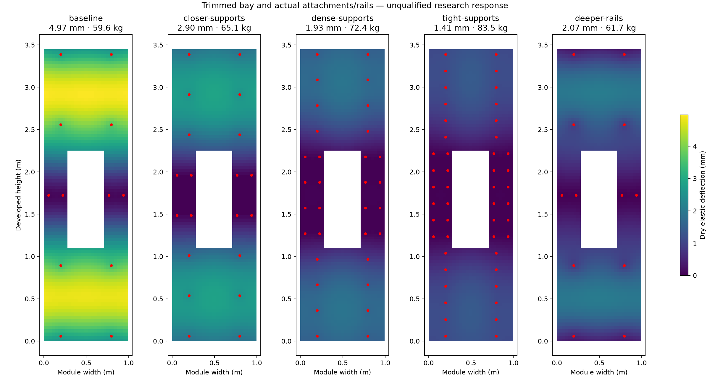

# Clipped panel response refinement

This study continues the [shared engineering demonstrators](../design_consistency/README.md) with a trimmed flat plate, individual attachments and actual hollow support rails. It addresses global pressure deflection and load sharing. Local contact, pull-out, debonding, fatigue, fire, curved-roof response and measured correlation remain open; no design is released.

The plate reads each manufactured ply's angle, thickness and coordinates, solid edge/aperture lands, core and insert regions from the same contract used by native FreeCAD. A rectangular MITC4 formulation uses mixed edge shear interpolation, with a homogeneous cylindrical plate checked against both an analytical solution and an independently executed CalculiX S8R model. That check verifies the element formulation, not the project laminate or joint properties. The method follows [Bathe and Dvorkin's plate formulation](https://doi.org/10.1002/nme.1620210213); the native solver uses the [CalculiX element/input definitions](https://www.dhondt.de/ccx_2.22.pdf).

Each clip connects to a real rail beam through provisional bolt/potting compliance. Rail bending uses its manufactured hollow-section inertia. Bracket ends are idealised as simply supported, including assumed aperture-frame anchorage. The joint springs are bilateral elastic seeds; actual gaps, friction, peel, pull-out and weld resistance are not established. Bond/finish extensional stiffness is uncredited. Circular insert/bore regions use quadrature within the rectangular mesh; local stresses at those boundaries are not qualified. Membrane-free ABD condensation is a local plate assumption, not a complete membrane/contact model. Material values are dry nominal development inputs at room temperature.



[Results](examples/summary.json) compare nominal spacing of 1.0, 0.5, 0.33 and 0.2 m, plus a 40 mm rail-depth alternative at the baseline spacing. The deeper alternative keeps the clip contact plane and moves brackets and the aperture frame behind the new rail depth. Both the geometry and material quantities change. Defined mass excludes the still-unresolved seal/secondary-retention and final connection details.

A 0.35 m proposal was rejected before ranking because two potting regions lacked matching foam subtractions; the [retained rejection](examples/manufacturing-rejection.json) binds that failure to its proposed geometry. Native volume/overlap checks remain mandatory after this analytical preflight.

Every accepted arrangement is solved at two mesh sizes, at 2 kPa, with softer joint springs, at a separate 3.5 kPa pressure, with every individual clip removed, and with higher pressure combined with the worst clip loss. Exact rank-one updates of the linear system evaluate all loss locations; a direct reassembly independently checks the worst case. Selecting only the most-loaded clip would miss the governing end-attachment loss.

The baseline's dry global deflection is near the 5 mm study limit, while individual clip loss and the pressure holdout expose failures. Closer supports improve deflection but add rails, brackets, fasteners, inserts and inspection work. Deeper rails improve nominal stiffness with a smaller mass increase, but do not resolve the end-attachment loss. The 0.2 m arrangement meets these specified elastic deflection cases with substantially more mass and attachments. This is a conditional research comparison, not a verified railway solution or an optimum. Strength, fatigue, fire, installation access, repair time, supplier pricing and physical tests remain mandatory and unresolved.

[Native geometry evidence](examples/cad/verification.json) checks occupied-material volumes, overlap, restored part identities and STEP reimport for all five arrangements. [Numerical evidence](examples/manifest.json) binds complete meshes, responses, attachment forces, rail reactions, formulation verification and the comparison figure to source hashes. The older train structural failures and roof thermal failure remain unchanged.

Reproduce:

```sh
.venv/bin/python tools/automation/panel-response-study.py
flatpak run --filesystem=/home/hayder/Documents/OpenSourceRail --command=FreeCADCmd org.freecad.FreeCAD tools/automation/verify-panel-response-cad.py
.venv/bin/python tools/automation/panel-response-study.py --check
.venv/bin/python -m pytest -q engineering/analysis/tests/test_panel_response.py
```

Use the [existing research dependencies](../design_consistency/requirements.txt), plus Matplotlib for the standalone figure. FreeCAD and CalculiX are required for native evidence. The next refinement requires controlled constitutive/contact data and local joint/edge models before prototype correlation or any physical release.
